# Sesión 19 · Sistemas robotizados. Actuadores (04/11/2026)

> **RA4.** Analiza sistemas robotizados, evaluando opciones de diseño e implementación. Esta primera sesión asienta la teoría: qué es un robot, su anatomía, la cinemática (FK/IK) y las técnicas de programación.

> **Hardware del aula:** un brazo **DOBOT Magician** (4 ejes) + cinta transportadora con fotocélula y sensor de color.

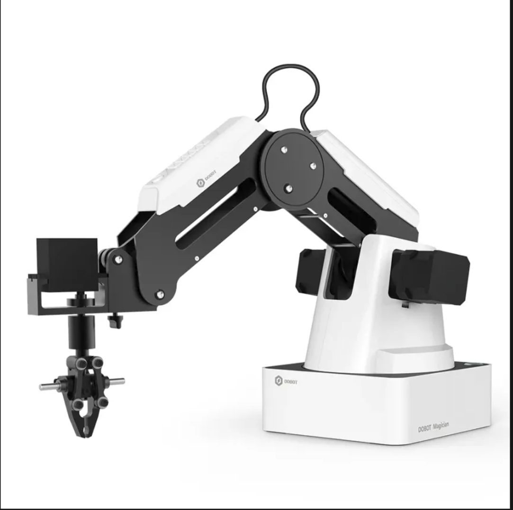

## Vídeo · El DOBOT Magician

<iframe width="100%" height="380" src="https://www.youtube.com/embed/QvRqFUxi0tY" title="Robot Dobot Magician - el robot perfecto para educación" frameborder="0" allow="accelerometer; autoplay; clipboard-write; encrypted-media; gyroscope; picture-in-picture; web-share" referrerpolicy="strict-origin-when-cross-origin" allowfullscreen></iframe>

[Ver en YouTube](https://www.youtube.com/watch?v=QvRqFUxi0tY) · Presenta el **DOBOT Magician** y por qué es el robot idóneo para educación.

??? note "Qué explica el vídeo"
    Presenta el **DOBOT Magician** y por qué es el robot perfecto para **educación**: 4 ejes, efectores intercambiables (pinza, ventosa, portaminas), programación por bloques (Blockly) o con Python, y sus aplicaciones típicas (*pick & place*, dibujo, escritura). Es el brazo que usaremos en el aula, así que sirve de presentación para las sesiones prácticas.

## Cuaderno de la sesión

El código se trabaja en el cuaderno **`sesion19_sistemas_robotizados.ipynb`**:

[Abrir en Colab](https://colab.research.google.com/github/jmperez-profesor/mia/blob/main/docs/bloques/B04_RA4/sesion19_sistemas_robotizados.ipynb){ .md-button } · [ver en el sitio](sesion19_sistemas_robotizados.ipynb)

## Qué vas a aprender

| # | Al terminar la sesión serás capaz de… |
|---|---|
| 1 | Definir un **robot** (ISO 8373) y clasificar los tipos principales |
| 2 | Describir la **anatomía** de un manipulador y los **grados de libertad** |
| 3 | Explicar la **cinemática directa e inversa** y sus problemas (soluciones múltiples, singularidades) |
| 4 | Distinguir **actuadores, sensores y efectores**, y las **técnicas de programación** |

## 1. Por qué robótica en 2026

La robótica es el campo de la IA que **cambia el estado del mundo físico**. Un clasificador que se equivoca produce una etiqueta errónea; un robot que se equivoca rompe una pieza, daña una máquina o lesiona a una persona. Esa responsabilidad física lo hace distinto de todo lo demás que hemos visto en el módulo.

Los números del sector lo confirman. Según la **IFR (*International Federation of Robotics*), *World Robotics* 2026** (datos de 2025):

| Dato | Valor |
|---|---|
| Robots industriales instalados en 2025 | **603.307** (+11 %, primera vez por encima de 600.000) |
| Stock operativo mundial | **5,08 millones** (+9 %, supera por primera vez los 5 millones) |
| País líder en densidad | **Corea del Sur** (>1.000 robots por 10.000 empleados) |
| Mayor instalador | **China** (354.000 unidades, 59 % del mundo) |
| **España** | **~4.300 unidades** en 2025 (impulso de la automoción) |
| **Unión Europea** | **712.000** robots operativos (84 % de Europa) |

> **Definición (ISO 8373).** Un **robot industrial** es un manipulador multifuncional, reprogramable y controlado automáticamente, programable en tres o más ejes, que puede estar fijo o móvil, y que se usa en aplicaciones de automatización industrial. Un **robot de servicio** es el que realiza tareas útiles para humanos fuera de la fabricación (logística, salud, agricultura, limpieza).

Un robot es un **agente encarnado**: percibe su entorno, lo procesa y **actúa físicamente** sobre él.

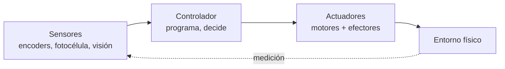

## 2. Tipos de robot y breve historia

**Tipos** (por su mecánica y su relación con las personas):

| Tipo | Qué es | Ejemplo |
|---|---|---|
| **Manipulador / brazo** | Cadena de eslabones que mueve un efector | DOBOT Magician |
| **Móvil** | Se desplaza sobre ruedas o patas | AGV/AMR de almacén |
| **Colaborativo (cobot)** | Comparte espacio con personas con fuerza limitada | DOBOT en modo guiado |
| **Pórtico / cartesiano** | Ejes lineales | Máquina de *pick & place* |
| **Aéreo / submarino** | Drones y vehículos de exploración | Cuadricópteros, AUV |
| **Humanoide** | Forma humana, bipedestación | Figure, Optimus, Unitree |

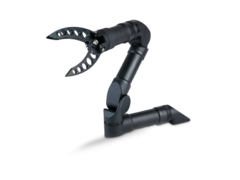

> **Más información · Historia de la robótica industrial.**
>
> - **1961 — Unimate.** El primer robot industrial entra en la cadena de montaje de General Motors (Ewing, Nueva Jersey) para manipular piezas calientes de fundición. Nace la robótica industrial.
> - **1966 — Shakey.** El primer robot móvil con «inteligencia» (SRI), pionero de la percepción y la planificación.
> - **1978 — PUMA.** Brazo de 6 ejes que se convierte en el estándar de la industria durante dos décadas (el `Puma560` sigue siendo el ejemplo canónico de la cinemática).
> - **2000 — da Vinci.** La cirugía robótica por telemanipulación entra en los quirófanos.
> - **2002 — Roomba.** La robótica de servicio llega a los hogares.
> - **2008 — Cobots.** Universal Robots populariza el robot colaborativo sin vallado.
> - **2012 — Amazon Robotics (Kiva).** Más de un millón de robots de almacén mueven los pedidos del comercio electrónico.
> - **2020s — Humanoides y *foundation models*.** Figure, Tesla Optimus, Unitree y los modelos **VLA** (*vision-language-action*) abren la nueva ola.
> - **2026 — Reajuste humanoide.** Según la IFR, en 2025 solo se vendieron **~7.000 humanoides** para uso industrial/profesional (muchos para generar datos de entrenamiento de IA). La «fiebre» inicial se está enfriando: los fabricantes que los prueban suelen operar con menos de 10 máquinas.

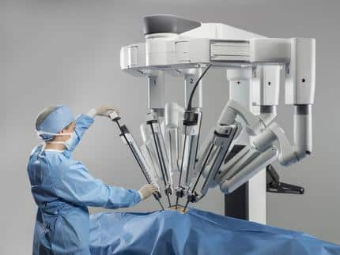

## 3. Anatomía de un manipulador

Un manipulador es una **cadena cinemática**: eslabones rígidos unidos por articulaciones.

> **Definición · Grado de libertad (GDL o DoF).** Cada movimiento independiente de una articulación. Hacen falta **al menos 3** para alcanzar cualquier punto del espacio (posición) y **6** para fijar además la orientación. El DOBOT Magician tiene **4** (base, brazo trasero, antebrazo y rotación de muñeca), lo que basta para *pick & place* y dibujo, pero **no** para orientar libremente una herramienta en 3D.

| Concepto | Definición |
|---|---|
| **Eslabón** | Pieza rígida entre dos articulaciones |
| **Articulación de revolución (R)** | Gira: variable ángulo θ |
| **Articulación prismática (P)** | Se desliza: variable distancia d |
| **Espacio articular** | Vector con el valor de cada articulación `[J1, J2, J3, J4]` |
| **Espacio cartesiano** | Pose del efector `[X, Y, Z, RZ]` (posición + giro de muñeca) |

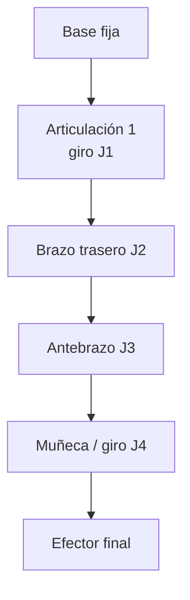

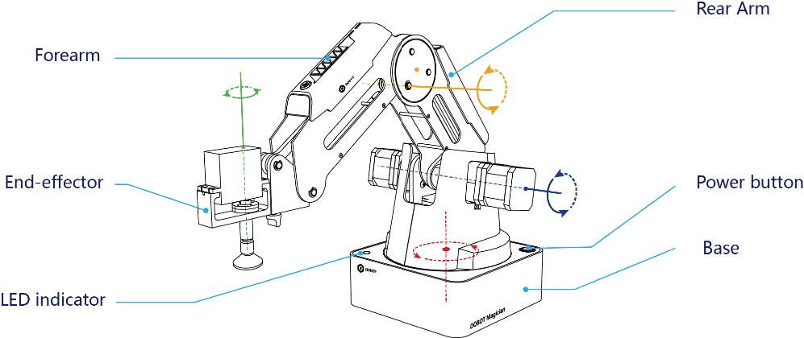

*Partes del DOBOT Magician (base, brazo trasero, antebrazo, muñeca y efector). Fuente: UAL Creative Computing Institute.*

<iframe width="100%" height="380" src="https://www.youtube.com/embed/la6eiP6hIpY" title="Introducción a la Robótica | Grados de Libertad | Cinemática Directa e Inversa" frameborder="0" allow="accelerometer; autoplay; clipboard-write; encrypted-media; gyroscope; picture-in-picture; web-share" referrerpolicy="strict-origin-when-cross-origin" allowfullscreen></iframe>

[Ver en YouTube](https://www.youtube.com/watch?v=la6eiP6hIpY) · *Cristian Trejo*. Grados de libertad y cinemática directa e inversa, con diapositivas y animaciones. Una buena introducción a los **grados de libertad**.

**Configuraciones típicas:** **articulado** (≥3R, el 6-ejes industrial), **cartesiano/pórtico** (3P), **SCARA** (RRP, montaje electrónico) y **delta** (paralelo, empaquetado de alta velocidad).

### Espacio de trabajo

El **espacio de trabajo** es la región del espacio a la que el efector puede llegar. No es ni un cubo ni una esfera completa: lo delimitan la **longitud de los eslabones**, el **alcance máximo** (320 mm en el DOBOT) y los **topes de giro** de cada articulación.

**Vista 1**

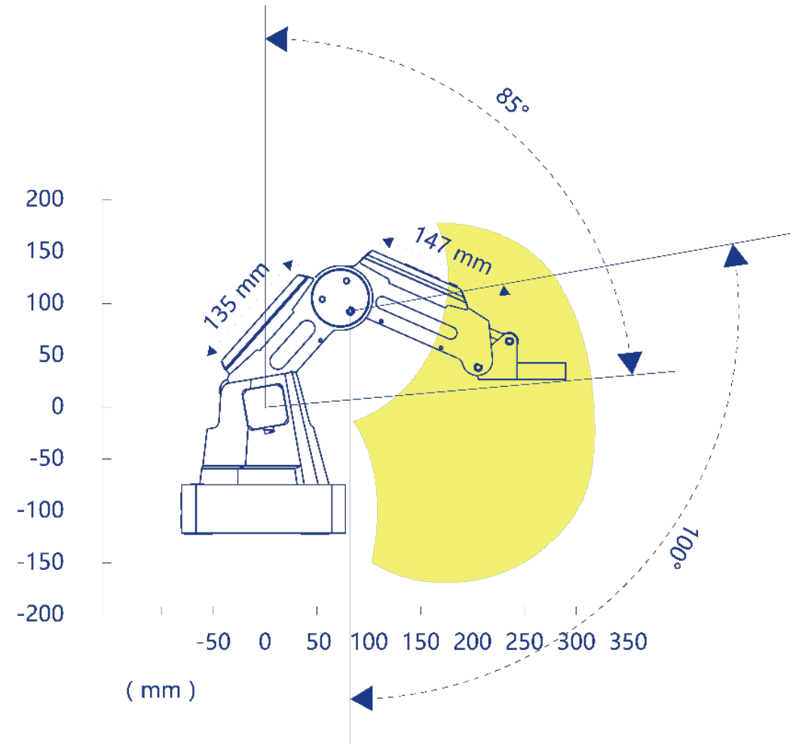

**Vista 2**

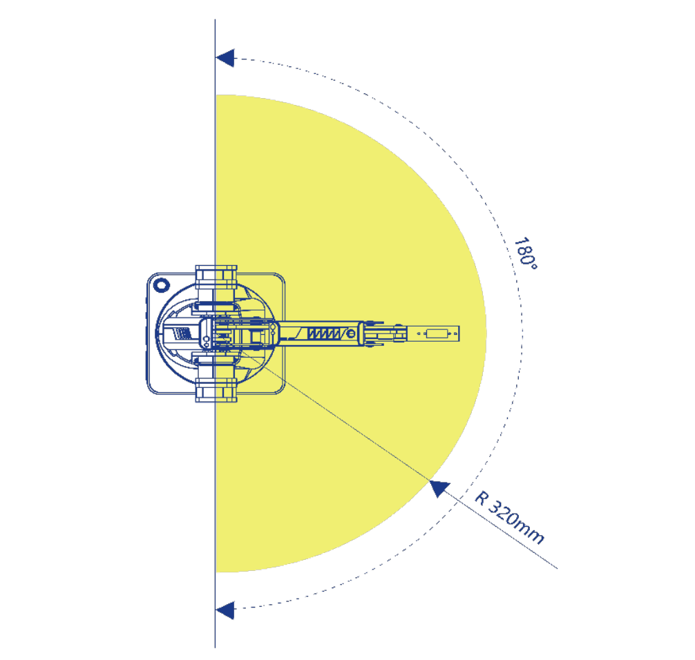

*Dos vistas del espacio de trabajo del DOBOT Magician. Observa que hay zonas próximas a la base y por detrás del brazo a las que **no** puede llegar: por eso conviene comprobar el alcance antes de programar un punto.*

### Sistema de coordenadas

El DOBOT Magician usa **dos sistemas de coordenadas** para referirse a la posición del efector: el **espacio articular** (por ángulos) y el **espacio cartesiano** (por coordenadas X, Y, Z y giro).

**Sistema de articulaciones (espacio articular)**

Se describe con el ángulo de cada articulación: `[J1, J2, J3, J4]`. Es como «siente» el robot internamente.

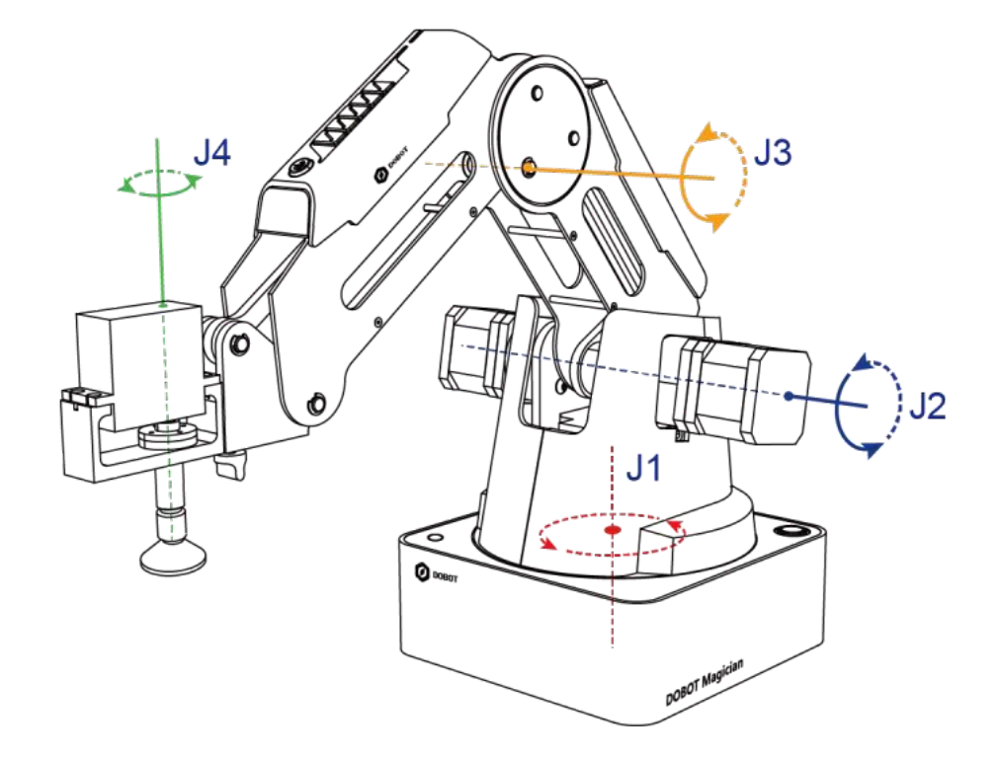

**Sistema cartesiano (espacio cartesiano)**

Se describe con la pose del efector: `[X, Y, Z, RZ]` (posición en mm + giro de la muñeca). Es como **pensamos** nosotros la posición.

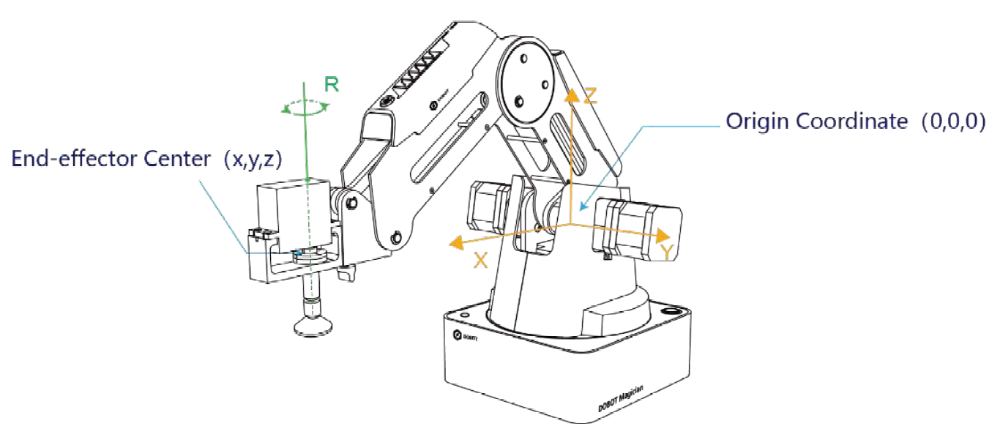

> **Ver el DOBOT en 3D.** [RoboDK for Web](https://robodk.com/3D/es/robot/Dobot-Magician) tiene un **visor 3D del DOBOT Magician** en el navegador (sin instalar nada): rota y haz zoom para ver los **4 ejes** y la cadena cinemática *base → brazo trasero → antebrazo → muñeca*. Complementa la vista XY de `BrazoSimulado` con una perspectiva real en 3D.

### DobotLab

Accede a [DobotLab](https://dobotlab.dobot.cc/#/), la plataforma web de Dobot para **educación en IA** con los brazos Magician. Incluye simulación virtual y programación por bloques. Para conectar con el brazo real hace falta **DobotLink**, un servicio intermedio (solo **Windows**).

**Página de inicio de DobotLab**
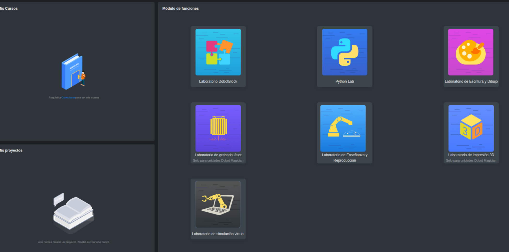

**Laboratorio de simulación virtual**
Haz clic en **Laboratorio de simulación virtual** para practicar movimientos y programas **sin conectar el robot real**.

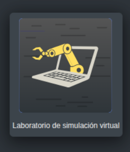

**Basic scene (escena básica)**
Haz clic en **Basic scene** para entrar en una escena en la que puedes **mover el brazo y coger piezas**.

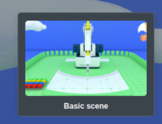

**Laboratorio de DobotBlock**
Haz clic en **Laboratorio de DobotBlock** para programar por bloques.

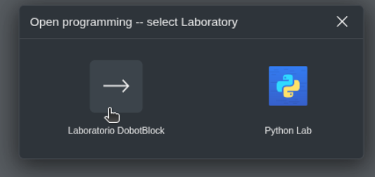

**Página de inicio de la Basic scene**
Al entrar en la *Basic scene* te pedirá **permisos de acceso a la cámara**; los puedes rechazar.

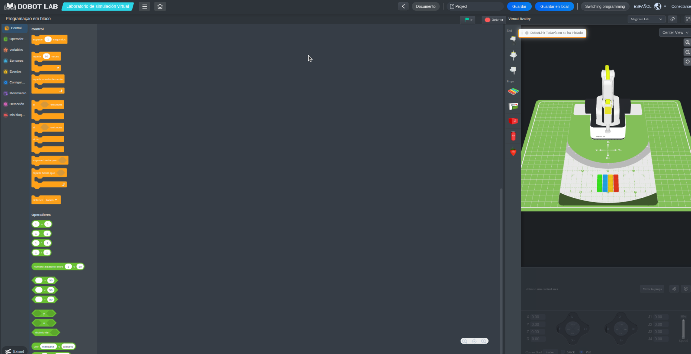

**Instalación de DobotLink**
Para conectar DobotLab con el brazo real aparece un aviso para instalar **DobotLink**:

**DobotLink** es una capa de servicio intermedia (desarrollada en Qt5) que actúa de **puente de comunicación** entre DobotLab y el hardware de los brazos Dobot (Magician, Magician Lite, Magician Go).

Al hacer clic en el aviso se abre una ventana para **descargar DobotLink** o, si ya está instalado, pulsar **«Poner en marcha»**:

DobotLink ya instalado y en marcha:

### Barra de herramientas de DobotLink

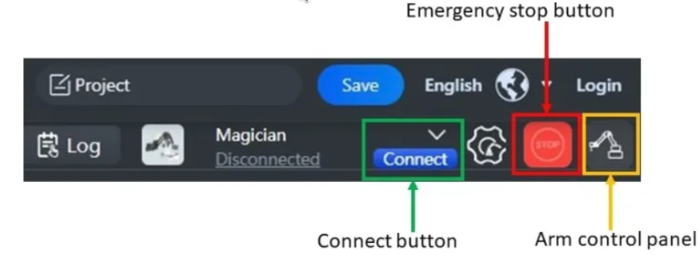

### Panel de control del Dobot Magician

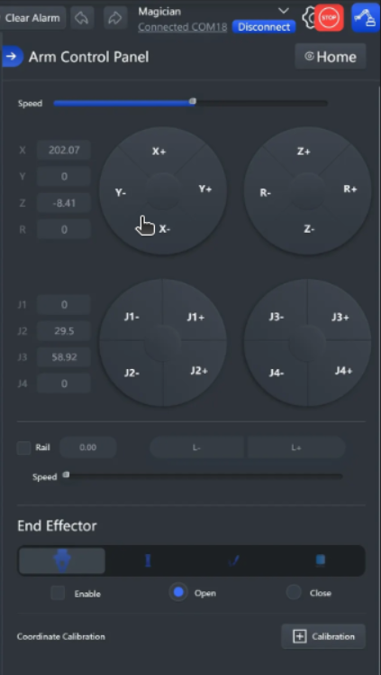

*Con el panel de control se mueve cada articulación (J1–J4) o se desplaza el efector en cartesianas, y se abren/cierran la pinza o la ventosa.*

## 4. Cinemática: el problema de los manipuladores (CE 4a)

**La idea en una frase.** El robot se mueve por **ángulos** (lo que giran los motores), pero tú piensas en **posiciones** (dónde quieres la pinza). La **cinemática** es el *traductor* entre esos dos mundos: relaciona los ángulos de las articulaciones con la posición de la punta, sin meterse con las fuerzas.

**Tu brazo como ejemplo.** Piensa en tu propio brazo (hombro + codo):

- **Cinemática directa (FK)** — la dirección *fácil*: *«si subo el hombro 90° y estiro el codo, mi mano acaba ahí»*. De **ángulos → posición**. Es como seguir una receta: paso a paso, sin sorpresas, y con una única respuesta.
- **Cinemática inversa (IK)** — la dirección *difícil*: *«quiero coger el vaso que está aquí, ¿qué ángulos pongo en el hombro y el codo?»*. De **posición → ángulos**. Puedo llegar con el **codo arriba o abajo** (dos soluciones) o, si el vaso está lejos, **no llegar**.

### 4.1 Cinemática directa (FK): de los ángulos a la posición

**El problema.** Conoces los ángulos y quieres saber dónde queda la punta. La respuesta es **única y directa**: se **suman los tramos** de cada eslabón.

Imagina un **brazo plano** de dos eslabones (como el tuyo, visto de lado):

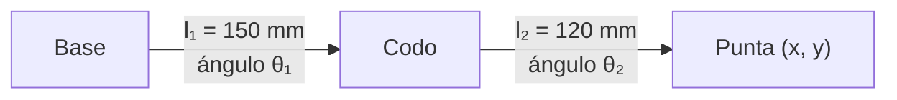

??? note "¿Y las cuentas? El brazo 2R, con fórmulas (opcional)"

    Con `l₁ = 150 mm` y `l₂ = 120 mm`, y dos ángulos `θ₁` (primer eslabón) y `θ₂` (segundo, respecto al primero):

    1. El **primer eslabón** apunta en la dirección `θ₁`; su extremo (el codo) queda en:
       $$x_1 = l_1\cos\theta_1 \qquad y_1 = l_1\sin\theta_1$$
    2. El **segundo eslabón** sale del codo en la dirección total `θ₁ + θ₂`:
       $$x_2 = l_2\cos(\theta_1+\theta_2) \qquad y_2 = l_2\sin(\theta_1+\theta_2)$$
    3. La **punta** es la suma de los dos tramos:
       $$x = l_1\cos\theta_1 + l_2\cos(\theta_1+\theta_2)$$
       $$y = l_1\sin\theta_1 + l_2\sin(\theta_1+\theta_2)$$

    **Con números (ángulos «fáciles», sin calculadora):**

    | Ángulos | Posición de la punta | Qué significa |
    |---|---|---|
    | `θ₁ = 0°`, `θ₂ = 0°` | `(150 + 120, 0) = (270, 0) mm` | Brazo **estirado** hacia delante: alcance máximo |
    | `θ₁ = 90°`, `θ₂ = 0°` | `(0, 150 + 120) = (0, 270) mm` | Brazo **estirado** hacia arriba |

    **Idea clave:** con el brazo **estirado** (`θ₂ = 0°`), la punta está siempre a `l₁ + l₂ = 270 mm` de la base. Por eso **270 mm es el alcance máximo**; el DOBOT llega a 320 mm, así que este brazo **cabe** en su zona de trabajo.

    > **En un robot real.** La FK se resuelve encadenando **matrices de transformación homogénea** con los **parámetros de Denavit-Hartenberg (DH)** (4 números por articulación). Es el método estándar de la industria, pero la idea es la misma: **sumar tramos** hasta llegar a la punta.

### 4.2 Cinemática inversa (IK): de la posición a los ángulos

**El problema.** Quieres la punta en un punto concreto y preguntas qué ángulos hacen falta. Es **más difícil** porque no siempre hay una única respuesta (y a veces no hay ninguna):

| Problema | En qué consiste | Consecuencia práctica |
|---|---|---|
| **Varias soluciones** | El mismo punto se alcanza con «codo arriba» o «codo abajo» | Dos programas distintos dibujan el mismo punto |
| **Singularidad** | El brazo queda en una postura que «pierde» un grado de libertad (p. ej. totalmente estirado) | Vibración o parada de seguridad al acercarse |
| **Fuera de alcance** | El punto pedido está a más de 270 mm (320 en el DOBOT) | El robot no llega: acercar el objeto o rediseñar la célula |
| **Límites articulares** | Algún eje no puede girar tanto | Movimiento imposible aunque el punto parezca alcanzable |

**Con el DOBOT:** cuando lo mueves con el *teach pendant* y grabas un punto, es el **controlador** quien resuelve la IK por ti. Por eso programar «a ojo» sin comprobar el alcance es la primera causa de error. Lo practicas en el cuaderno [sesion19_sistemas_robotizados.ipynb](sesion19_sistemas_robotizados.ipynb).

### 4.3 Control

Los ejes se mueven con **servomotores con encoder** en **lazo cerrado**: el motor «sabe» dónde está y se corrige solo. El control clásico por eje va de **P → PD → PID** (cada vez corrige más: primero el error, luego su velocidad, luego el error acumulado). En el DOBOT, la **velocidad** y la **aceleración** de cada tramo se fijan con parámetros (`SetPTPJointParams`, `SetPTPCoordinateParams`).

> **Definición · Repetibilidad vs. precisión.** La **repetibilidad** es la dispersión al volver al mismo punto programado (**±0,2 mm** en el DOBOT): si lo mandas 100 veces al mismo punto, ¿cuánto se separa? La **precisión** es si ese punto coincide con el que **querías** alcanzar. Un robot puede ser muy repetible y a la vez impreciso. Con *teach pendant* basta la repetibilidad; con programación **offline** (coordenadas de CAD) la precisión es crítica.

## 5. Actuadores, sensores y efectores finales

**Actuadores:**

| Tipo | Cómo funciona | Dónde |
|---|---|---|
| **Eléctrico** | Motor que gira | Articulaciones (el del DOBOT) |
| **Neumático** | Aire comprimido | Pinza y ventosa |
| **Hidráulico** | Fluido a presión | Maquinaria pesada |

**Sensores:** los **propioceptivos** informan del propio robot (**encoders** de eje, finales de carrera) y los **exteroceptivos** del entorno (**fotocélula**, **sensor de color**, **visión**). El DOBOT usa encoders internos y, con el kit de cinta, una fotocélula y un sensor de color.

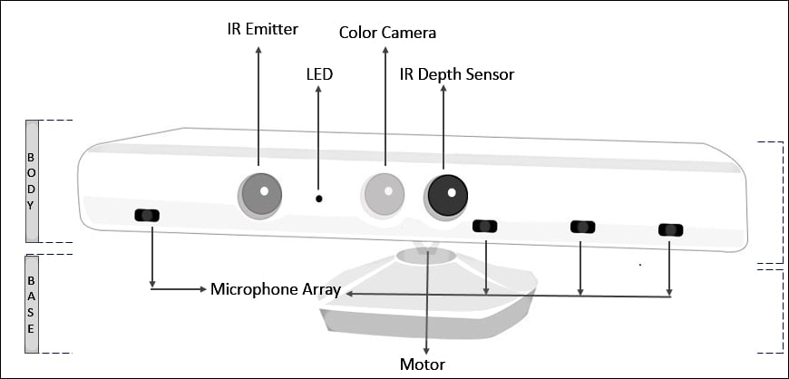

> **Definición · Efector final (EOAT, *end of arm tooling*).** La herramienta del extremo del brazo. El DOBOT Magician los tiene intercambiables:

| Efector | Para qué | Dato |
|---|---|---|
| **Portaminas / rotulador** | Dibujar y escribir | Ø 10 mm |
| **Pinza neumática** | Coger objetos rígidos | recorrido 27,5 mm, fuerza 8 N |
| **Ventosa** | Coger objetos planos/lisos | Ø 20 mm, −35 kPa |
| **Impresión 3D / láser** | Mención (no se usan en clase) | — |

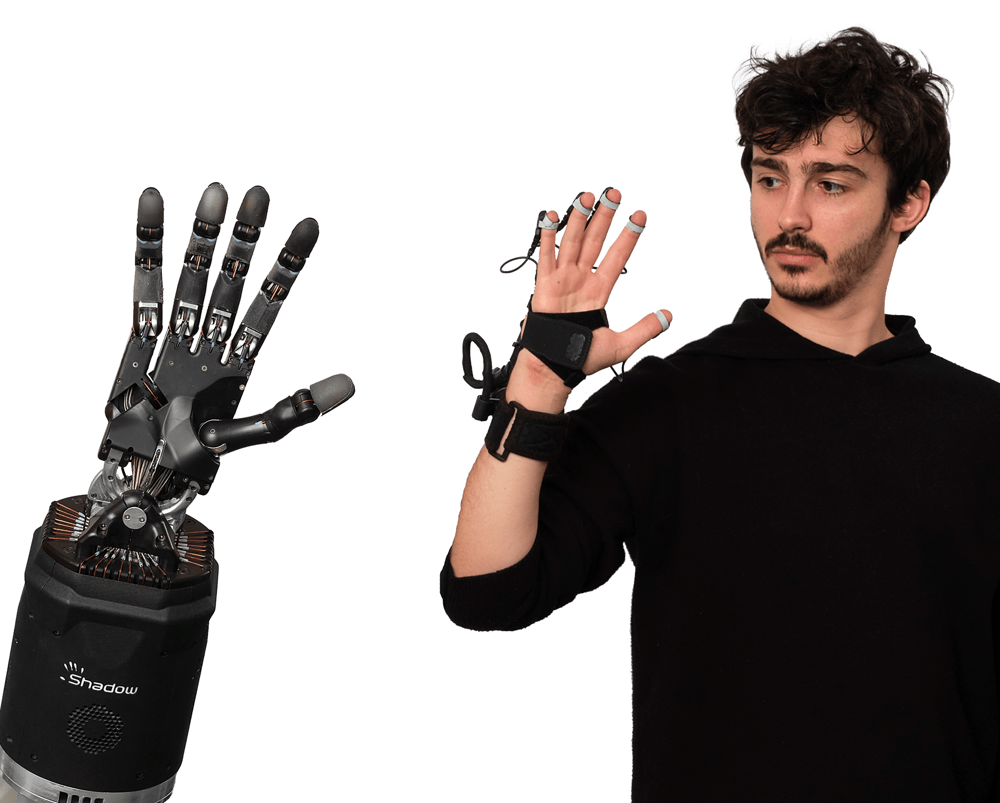

> **Ejemplo · El caso de la ventosa.** Una ventosa no «agarra»: **aspira**. Con −35 kPa y Ø 20 mm, la fuerza teórica de sujeción es `F = P · A ≈ 35000 Pa × π·(0,01 m)² ≈ 11 N`, suficiente para un cubo ligero pero **no** para una pieza pesada o porosa. Elegir efector es parte del diseño. Una **mano antropomórfica** puede tener 20 actuadores y mucha más destreza, pero **controlarla es mucho más difícil**: más grados de libertad = más que decidir.

## 6. El sistema robotizado: robot + controlador + entorno (CE 4d)

Un **sistema robotizado** no es solo el brazo: es la **célula** completa.

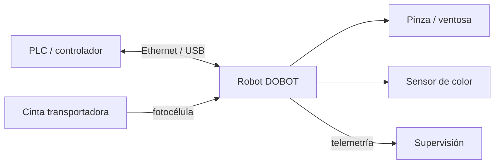

| Elemento | Función |
|---|---|
| **Robot + controlador** | Ejecuta el programa y gobierna los ejes |
| **Entorno** | Cinta, sensor de presencia, sensor de color, mesa de trabajo |
| **PLC / comunicaciones** | Coordina robot y periféricos (en el DOBOT, por su API) |
| **Seguridad** | Paradas, límites de movimiento, no invadir la trayectoria |

**Aplicaciones típicas** (las que se practican en el aula): **pick & place**, **paletizado** (dejar piezas en filas y capas), **clasificación por color** y **dibujo/escritura** con portaminas.

> **Más información · Diseño centrado en la tarea.** En la industria, la célula se diseña **empezando por la tarea**: qué pieza, qué peso, qué cadencia, qué precisión y qué entorno. Después se elige robot (carga útil, alcance, repetibilidad) y efector. El DOBOT tiene **500 g de carga útil**, **320 mm de alcance** y **±0,2 mm de repetibilidad**: suficiente para piezas ligeras y trabajos de precisión de laboratorio, no para piezas de varios kilos.

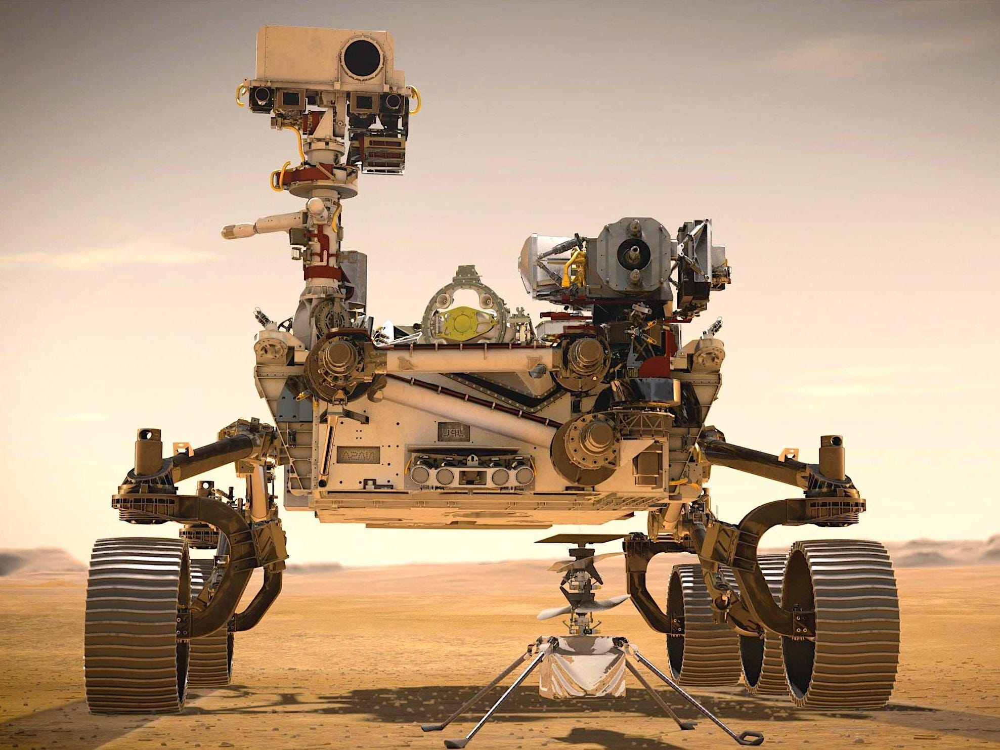

## 7. Técnicas de programación de robots (CE 4c)

> **Definición.** Programar un robot es decirle **qué trayectoria** seguir y **cuándo** actuar sobre el efector. Hay varias técnicas, y cada una cambia quién escribe el movimiento y cuánto se tarda.

| Técnica | Cómo funciona | Ventaja | Inconveniente | Cuándo |
|---|---|---|---|---|
| **Guiado / teach pendant** | Mueves el brazo a mano o con la botonera y grabas puntos | Rapidísima, sin código | Poco flexible; el robot está parado | Trayectorias simples, puntos de paso |
| **Programación por bloques (Blockly)** | Encajas bloques de movimiento | Muy visual, ideal para aprender | Limitada (p. ej. sin arcos) | Docencia, prototipos |
| **Programación textual (Python + API)** | Escribes el script con `pydobot`/`dType` | Repetible, parametrizable, versionable | Requiere saber programar | Aula y producción real |
| **Online** | Se ejecuta sobre el robot conectado | Feedback inmediato | Ocupa el robot mientras programas | Puesta a punto |
| **Offline** | Se escribe y **valida sin el robot** | **Cero paro**; varios equipos a la vez | Exige comprobar límites por software | Nuestro caso: un solo brazo |

> **Ejemplo · Nuestro flujo (offline con validación).** Con **un solo brazo** para todo el grupo: cada equipo escribe y **comprueba** su script en un cuaderno Colab (sintaxis, número de parámetros, rangos, límites del espacio de trabajo) → lo entrega → el docente lo carga y lo ejecuta en el brazo → si falla, se depura en directo. Es el ciclo real **programo → compruebo → envío → miro qué sale**.

> **Más información.** Los robots industriales usan lenguajes propietarios: **RAPID** (ABB), **KRL** (KUKA) y **URScript** (Universal Robots, muy parecido a Python). El estándar abierto es **ROS 2**, con **MoveIt 2** para manipulación y **Nav2** para navegación. En simulación se usan **NVIDIA Isaac Sim/Isaac Lab**, **MuJoCo** (DeepMind) y **Gazebo**.

## Actividad 1 · Cinemática de un manipulador (autónomo)

Prueba el código del **cuaderno de la sesión** (`sesion19_sistemas_robotizados.ipynb`) cambiando ángulos y puntos objetivo, y añade una **conclusión de 3–4 líneas** sobre los problemas de cinemática encontrados. Detalle en [actividades/act1_cinematica.md](actividades/act1_cinematica.md).

## Puntos clave

- Un robot es un **agente encarnado**: percibe, decide y **actúa físicamente** (ISO 8373).
- La **cinemática directa** (FK) tiene solución única; la **inversa** (IK) es el problema difícil (múltiples soluciones, singularidades, fuera de alcance).
- **Actuadores** (eléctrico/neumático/hidráulico), **sensores** (propioceptivos/exteroceptivos) y **efectores** (pinza/ventosa/portaminas).
- Las **técnicas de programación** van del guiado (teach) al código (Python), online u **offline**.
