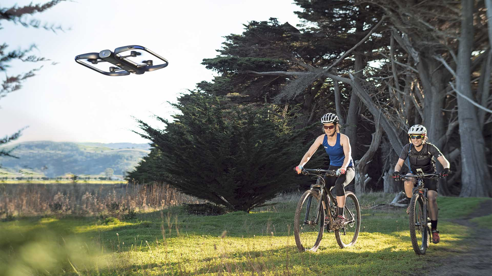

# Sesión 21 · Brazo robótico 2 (04/11/2026)

> **RA4.** Segunda sesión práctica: cambio a pinza/ventosa y misión de pick & place con la cinta, cerrando con aplicaciones y tendencias.

## Qué vas a aprender

| # | Al terminar la sesión serás capaz de… |
|---|---|
| 1 | Implementar una **célula de pick & place** con la cinta (fotocélula y sensor de color) |
| 2 | Elegir el **efector** adecuado (pinza vs. ventosa) y justificar el diseño |
| 3 | Situar las **aplicaciones y tendencias** de la robótica (cobots, humanoides, VLA, ISO 10218) |

## 9. Aplicaciones actuales y tendencias (2026)

| Ámbito | Ejemplo | Qué aporta |
|---|---|---|
| **Industria** | Soldadura, paletizado, *pick & place*, control de calidad | Cadencia y precisión constantes |
| **Salud** | Cirugía por telemanipulación (da Vinci), rehabilitación | Precisión milimétrica, menos invasión |
| **Logística** | AMR de almacén (Amazon Robotics, MiR) | Menos tiempo de desplazamiento |
| **Agricultura** | Drones de monitorización y riego de precisión | Menos coste e impacto ambiental |
| **Exploración** | Rovers y drones (Marte, inspección de infraestructuras) | Acceso a entornos peligrosos |

**Tendencias 2026:**

- **Cobots** en crecimiento: el criterio de compra ya no es solo «cuántos kilos», sino **facilidad para integrar visión y ROS 2**.
- **Humanoides** en pilotos de logística (Figure, Agility, Unitree); aún caros frente a un AMR.
- ***Foundation models* para robótica (VLA):** modelos como RT-2, OpenVLA, π0 o GR00T prometen «aprende la tarea viéndome hacerla», pero están en fase de investigación.
- **Sim-to-real:** entrenar en simulación (Isaac Lab, MuJoCo) y transferir al robot real, con datos sintéticos y *domain randomization*.
- **Seguridad y normativa:** la **ISO 10218:2025** absorbe los límites biomecánicos de la ISO/TS 15066 y añade ciberseguridad industrial; el **AI Act** clasifica como **alto riesgo** los componentes de seguridad y la maquinaria con IA.

> **Más información.** Para el montaje de una célula real se usan buses deterministas (**PROFINET**, **EtherCAT**) entre PLC y robot, y **OPC UA** o **MQTT** para publicar telemetría al MES y al **gemelo digital**, que anticipa fallos (fatiga de reductoras) antes de que paren la línea.

## Actividad 3 · Pick & place con pinza y cinta (presencial + autónomo)

Diseña una célula de pick & place: coge un objeto de la cinta y déjalo en la zona marcada, con memoria del equipo. Cuaderno [UD04_pick_place_plantilla.ipynb](colab/UD04_pick_place_plantilla.ipynb). Detalle en [actividades/act3_pick_place.md](actividades/act3_pick_place.md).

> **Ver el DOBOT en 3D.** [RoboDK for Web](https://robodk.com/3D/es/robot/Dobot-Magician) para inspeccionar el brazo y sus ejes antes de montar la célula.

## Puntos clave

- La **célula** completa (robot + cinta + sensor + seguridad) es lo que se diseña, no solo el brazo.
- La **pinza** agarra objetos rígidos; la **ventosa** aspira superficies lisas y no porosas.
- Tendencias: **cobots**, **humanoides**, *foundation models* (VLA), **sim-to-real** y la **ISO 10218:2025**.
