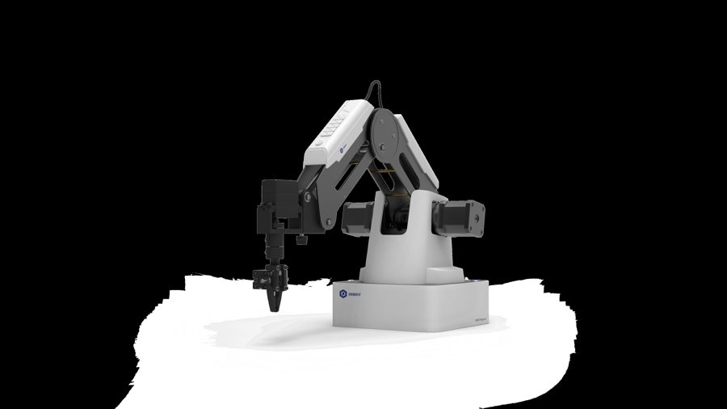
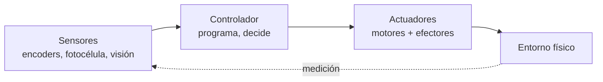
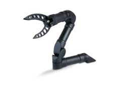
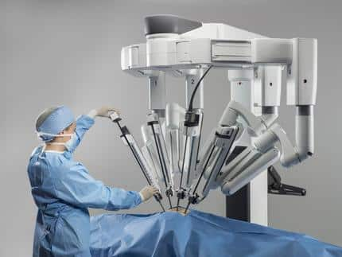
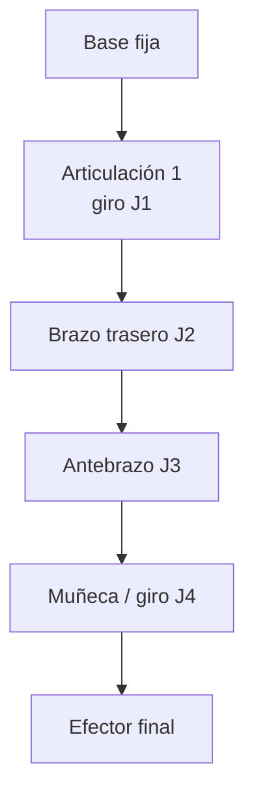
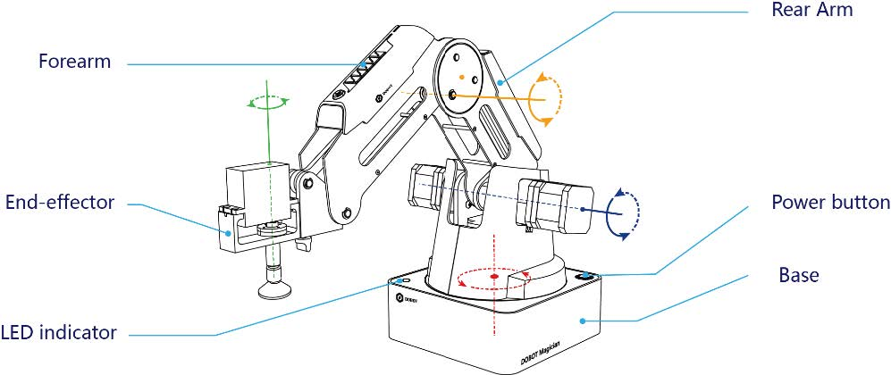
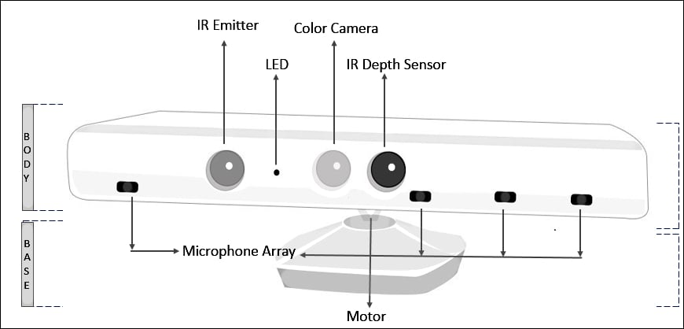
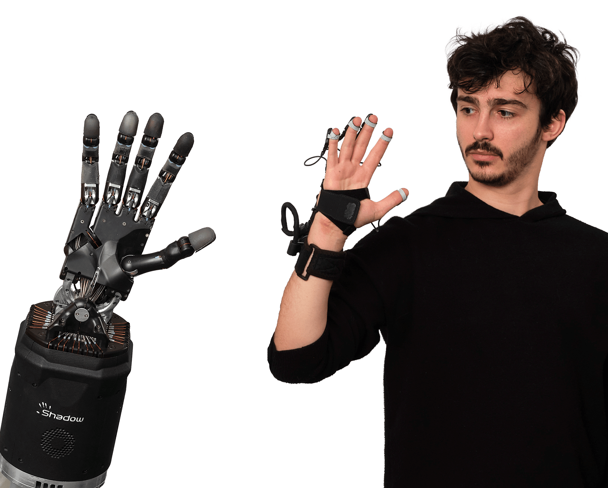
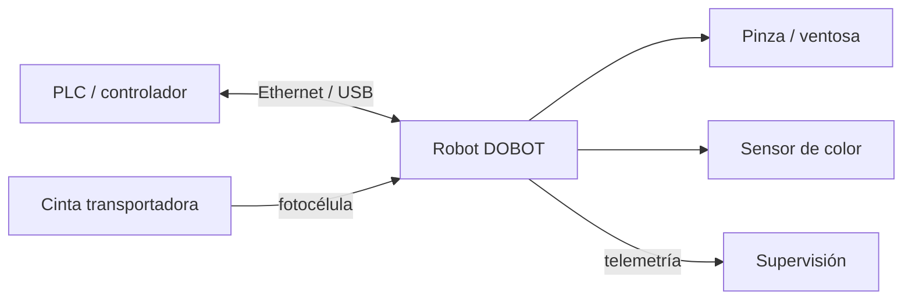
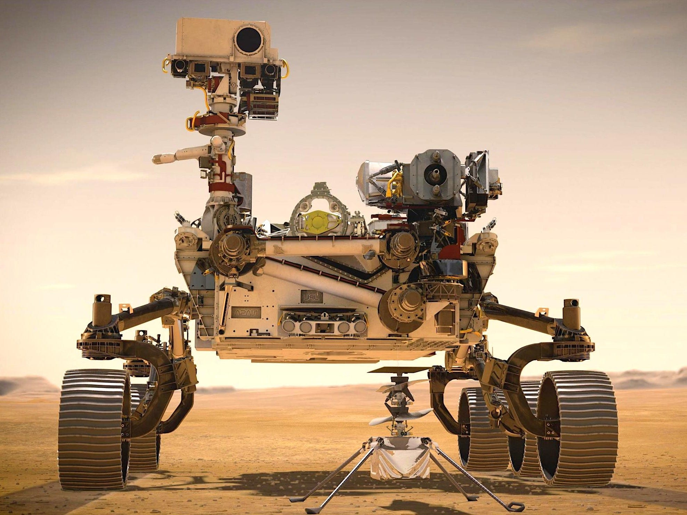

# Sesión 21 · Sistemas robotizados. Actuadores (04/11/2026)

> **RA4.** Analiza sistemas robotizados, evaluando opciones de diseño e implementación. Esta primera sesión asienta la teoría: qué es un robot, su anatomía, la cinemática (FK/IK) y las técnicas de programación.

> **Hardware del aula:** un brazo **DOBOT Magician** (4 ejes) + cinta transportadora con fotocélula y sensor de color.

## Qué vas a aprender

| # | Al terminar la sesión serás capaz de… |
|---|---|
| 1 | Definir un **robot** (ISO 8373) y clasificar los tipos principales |
| 2 | Describir la **anatomía** de un manipulador y los **grados de libertad** |
| 3 | Explicar la **cinemática directa e inversa** y sus problemas (soluciones múltiples, singularidades) |
| 4 | Distinguir **actuadores, sensores y efectores**, y las **técnicas de programación** |

## 1. Por qué robótica en 2026

La robótica es el campo de la IA que **cambia el estado del mundo físico**. Un clasificador que se equivoca produce una etiqueta errónea; un robot que se equivoca rompe una pieza, daña una máquina o lesiona a una persona. Esa responsabilidad física lo hace distinto de todo lo demás que hemos visto en el módulo.

Los números del sector lo confirman. Según la **IFR (*International Federation of Robotics*), *World Robotics* 2025** (datos de 2024):

| Dato | Valor |
|---|---|
| Robots industriales instalados en 2024 | **542.000** (4.º año por encima de 500.000) |
| Stock operativo mundial | **4,66 millones** (+9 %) |
| País líder en densidad | **Corea del Sur** (>1.000 robots por 10.000 empleados) |
| Mayor instalador | **China** (54 % de las instalaciones del mundo) |
| **España** | **3.er mercado europeo** (~5.100 unidades, tirón de la automoción) |
| Robótica médica | **+91 %**, con el sistema **da Vinci** como referencia |

> **Definición (ISO 8373).** Un **robot industrial** es un manipulador multifuncional, reprogramable y controlado automáticamente, programable en tres o más ejes, que puede estar fijo o móvil, y que se usa en aplicaciones de automatización industrial. Un **robot de servicio** es el que realiza tareas útiles para humanos fuera de la fabricación (logística, salud, agricultura, limpieza).

Un robot es un **agente encarnado**: percibe su entorno, lo procesa y **actúa físicamente** sobre él.

## 2. Tipos de robot y breve historia

**Tipos** (por su mecánica y su relación con las personas):

| Tipo | Qué es | Ejemplo |
|---|---|---|
| **Manipulador / brazo** | Cadena de eslabones que mueve un efector | DOBOT Magician |
| **Móvil** | Se desplaza sobre ruedas o patas | AGV/AMR de almacén |
| **Colaborativo (cobot)** | Comparte espacio con personas con fuerza limitada | DOBOT en modo guiado |
| **Pórtico / cartesiano** | Ejes lineales | Máquina de *pick & place* |
| **Aéreo / submarino** | Drones y vehículos de exploración | Cuadricópteros, AUV |
| **Humanoide** | Forma humana, bipedestación | Figure, Optimus, Unitree |

> **Más información · Historia de la robótica industrial.**
>
> - **1961 — Unimate.** El primer robot industrial entra en la cadena de montaje de General Motors (Ewing, Nueva Jersey) para manipular piezas calientes de fundición. Nace la robótica industrial.
> - **1966 — Shakey.** El primer robot móvil con «inteligencia» (SRI), pionero de la percepción y la planificación.
> - **1978 — PUMA.** Brazo de 6 ejes que se convierte en el estándar de la industria durante dos décadas (el `Puma560` sigue siendo el ejemplo canónico de la cinemática).
> - **2000 — da Vinci.** La cirugía robótica por telemanipulación entra en los quirófanos.
> - **2002 — Roomba.** La robótica de servicio llega a los hogares.
> - **2008 — Cobots.** Universal Robots populariza el robot colaborativo sin vallado.
> - **2012 — Amazon Robotics (Kiva).** Más de un millón de robots de almacén mueven los pedidos del comercio electrónico.
> - **2020s — Humanoides y *foundation models*.** Figure, Tesla Optimus, Unitree y los modelos **VLA** (*vision-language-action*) abren la nueva ola.

## 3. Anatomía de un manipulador

Un manipulador es una **cadena cinemática**: eslabones rígidos unidos por articulaciones.

> **Definición · Grado de libertad (GDL o DoF).** Cada movimiento independiente de una articulación. Hacen falta **al menos 3** para alcanzar cualquier punto del espacio (posición) y **6** para fijar además la orientación. El DOBOT Magician tiene **4** (base, brazo trasero, antebrazo y rotación de muñeca), lo que basta para *pick & place* y dibujo, pero **no** para orientar libremente una herramienta en 3D.

| Concepto | Definición |
|---|---|
| **Eslabón** | Pieza rígida entre dos articulaciones |
| **Articulación de revolución (R)** | Gira: variable ángulo θ |
| **Articulación prismática (P)** | Se desliza: variable distancia d |
| **Espacio articular** | Vector con el valor de cada articulación `[J1, J2, J3, J4]` |
| **Espacio cartesiano** | Pose del efector `[X, Y, Z, RZ]` (posición + giro de muñeca) |

*Partes del DOBOT Magician (base, brazo trasero, antebrazo, muñeca y efector). Fuente: UAL Creative Computing Institute.*

**Configuraciones típicas:** **articulado** (≥3R, el 6-ejes industrial), **cartesiano/pórtico** (3P), **SCARA** (RRP, montaje electrónico) y **delta** (paralelo, empaquetado de alta velocidad).

> **Ver el DOBOT en 3D.** [RoboDK for Web](https://robodk.com/3D/es/robot/Dobot-Magician) tiene un **visor 3D del DOBOT Magician** en el navegador (sin instalar nada): rota y haz zoom para ver los **4 ejes** y la cadena cinemática *base → brazo trasero → antebrazo → muñeca*. Complementa la vista XY de `BrazoSimulado` con una perspectiva real en 3D.

## 4. Cinemática: el problema de los manipuladores (CE 4a)

### 4.1 Cinemática directa (FK)

La **cinemática directa** calcula la **pose del efector** a partir de los valores de las articulaciones: `pose = f(q)`. Siempre tiene **una única solución** y es pura geometría.

> **Ejemplo · Brazo plano 2R resoluble a mano.** Dos eslabones de longitud `l₁ = 150 mm` y `l₂ = 120 mm`, con ángulos `θ₁` y `θ₂`. La punta está en:
> $$x = l_1\cos\theta_1 + l_2\cos(\theta_1+\theta_2)$$
> $$y = l_1\sin\theta_1 + l_2\sin(\theta_1+\theta_2)$$
> Con `θ₁ = 0°`, `θ₂ = 0°`: `x = 270 mm`, `y = 0 mm`. Con `θ₁ = 90°`, `θ₂ = 0°`: `x = 0`, `y = 270 mm`. Ese punto (270 mm) está **dentro** del alcance de 320 mm del DOBOT.

En un robot real, la FK se resuelve encadenando **matrices de transformación homogénea** descritas con los **parámetros de Denavit-Hartenberg (DH)** (θ, d, a, α por articulación). Es el método estándar de la industria.

### 4.2 Cinemática inversa (IK)

La **cinemática inversa** va al revés: dada la pose deseada, calcula los ángulos `q = f⁻¹(pose)`. Es **el problema difícil** y la raíz de casi todos los fallos de un manipulador:

| Problema | En qué consiste | Consecuencia práctica |
|---|---|---|
| **Múltiples soluciones** | Un mismo punto se alcanza con «codo arriba» o «codo abajo» | Dos scripts distintos dibujan el mismo punto |
| **Singularidad** | El jacobiano pierde rango: la velocidad articular tiende a infinito | Vibración, sobrecorriente o parada de seguridad |
| **Fuera de alcance** | El objetivo está más allá de 320 mm | El robot no llega: hay que rediseñar la célula |
| **Límites articulares** | Cada eje tiene un rango válido | Movimiento imposible aunque el punto sea alcanzable |

> **Más información.** En un brazo de 6 ejes la IK puede tener **hasta 16 soluciones**; el DOBOT, con 4 ejes, tiene menos margen y por eso su **espacio de trabajo** es un casquete cilíndrico en torno a su base. Programar «a ciegas» sin comprobar el alcance es la primera causa de error en el aula. Lo practicas en el cuaderno [UD04_cinematica.ipynb](colab/UD04_cinematica.ipynb).

### 4.3 Control

Los ejes se mueven con **servomotores con encoder** en lazo cerrado. El control clásico por eje es **P → PD → PID**; los robots industriales añaden **par calculado** (dinámica inversa). En el DOBOT, la velocidad y la aceleración de cada tramo se fijan con parámetros (`SetPTPJointParams`, `SetPTPCoordinateParams`).

> **Definición · Repetibilidad vs. precisión.** La **repetibilidad** es la dispersión al volver al mismo punto programado (**±0,2 mm** en el DOBOT); la **precisión** es si ese punto coincide con el que se quería alcanzar. Un robot puede ser muy repetible y a la vez impreciso. Con *teach pendant* basta la repetibilidad; con programación **offline** (coordenadas de CAD) la precisión es crítica.

## 5. Actuadores, sensores y efectores finales

**Actuadores:**

| Tipo | Cómo funciona | Dónde |
|---|---|---|
| **Eléctrico** | Motor que gira | Articulaciones (el del DOBOT) |
| **Neumático** | Aire comprimido | Pinza y ventosa |
| **Hidráulico** | Fluido a presión | Maquinaria pesada |

**Sensores:** los **propioceptivos** informan del propio robot (**encoders** de eje, finales de carrera) y los **exteroceptivos** del entorno (**fotocélula**, **sensor de color**, **visión**). El DOBOT usa encoders internos y, con el kit de cinta, una fotocélula y un sensor de color.

> **Definición · Efector final (EOAT, *end of arm tooling*).** La herramienta del extremo del brazo. El DOBOT Magician los tiene intercambiables:

| Efector | Para qué | Dato |
|---|---|---|
| **Portaminas / rotulador** | Dibujar y escribir | Ø 10 mm |
| **Pinza neumática** | Coger objetos rígidos | recorrido 27,5 mm, fuerza 8 N |
| **Ventosa** | Coger objetos planos/lisos | Ø 20 mm, −35 kPa |
| **Impresión 3D / láser** | Mención (no se usan en clase) | — |

> **Ejemplo · El caso de la ventosa.** Una ventosa no «agarra»: **aspira**. Con −35 kPa y Ø 20 mm, la fuerza teórica de sujeción es `F = P · A ≈ 35000 Pa × π·(0,01 m)² ≈ 11 N`, suficiente para un cubo ligero pero **no** para una pieza pesada o porosa. Elegir efector es parte del diseño. Una **mano antropomórfica** puede tener 20 actuadores y mucha más destreza, pero **controlarla es mucho más difícil**: más grados de libertad = más que decidir.

## 6. El sistema robotizado: robot + controlador + entorno (CE 4d)

Un **sistema robotizado** no es solo el brazo: es la **célula** completa.

| Elemento | Función |
|---|---|
| **Robot + controlador** | Ejecuta el programa y gobierna los ejes |
| **Entorno** | Cinta, sensor de presencia, sensor de color, mesa de trabajo |
| **PLC / comunicaciones** | Coordina robot y periféricos (en el DOBOT, por su API) |
| **Seguridad** | Paradas, límites de movimiento, no invadir la trayectoria |

**Aplicaciones típicas** (las que se practican en el aula): **pick & place**, **paletizado** (dejar piezas en filas y capas), **clasificación por color** y **dibujo/escritura** con portaminas.

> **Más información · Diseño centrado en la tarea.** En la industria, la célula se diseña **empezando por la tarea**: qué pieza, qué peso, qué cadencia, qué precisión y qué entorno. Después se elige robot (carga útil, alcance, repetibilidad) y efector. El DOBOT tiene **500 g de carga útil**, **320 mm de alcance** y **±0,2 mm de repetibilidad**: suficiente para piezas ligeras y trabajos de precisión de laboratorio, no para piezas de varios kilos.

## 7. Técnicas de programación de robots (CE 4c)

> **Definición.** Programar un robot es decirle **qué trayectoria** seguir y **cuándo** actuar sobre el efector. Hay varias técnicas, y cada una cambia quién escribe el movimiento y cuánto se tarda.

| Técnica | Cómo funciona | Ventaja | Inconveniente | Cuándo |
|---|---|---|---|---|
| **Guiado / teach pendant** | Mueves el brazo a mano o con la botonera y grabas puntos | Rapidísima, sin código | Poco flexible; el robot está parado | Trayectorias simples, puntos de paso |
| **Programación por bloques (Blockly)** | Encajas bloques de movimiento | Muy visual, ideal para aprender | Limitada (p. ej. sin arcos) | Docencia, prototipos |
| **Programación textual (Python + API)** | Escribes el script con `pydobot`/`dType` | Repetible, parametrizable, versionable | Requiere saber programar | Aula y producción real |
| **Online** | Se ejecuta sobre el robot conectado | Feedback inmediato | Ocupa el robot mientras programas | Puesta a punto |
| **Offline** | Se escribe y **valida sin el robot** | **Cero paro**; varios equipos a la vez | Exige comprobar límites por software | Nuestro caso: un solo brazo |

> **Ejemplo · Nuestro flujo (offline con validación).** Con **un solo brazo** para todo el grupo: cada equipo escribe y **comprueba** su script en un cuaderno Colab (sintaxis, número de parámetros, rangos, límites del espacio de trabajo) → lo entrega → el docente lo carga y lo ejecuta en el brazo → si falla, se depura en directo. Es el ciclo real **programo → compruebo → envío → miro qué sale**.

> **Más información.** Los robots industriales usan lenguajes propietarios: **RAPID** (ABB), **KRL** (KUKA) y **URScript** (Universal Robots, muy parecido a Python). El estándar abierto es **ROS 2**, con **MoveIt 2** para manipulación y **Nav2** para navegación. En simulación se usan **NVIDIA Isaac Sim/Isaac Lab**, **MuJoCo** (DeepMind) y **Gazebo**.

## Actividad 1 · Cinemática de un manipulador (autónomo)

Ficha de problemas + cuaderno [UD04_cinematica.ipynb](colab/UD04_cinematica.ipynb): calcula la **FK/IK de un brazo 2R** a mano y con NumPy, y dibuja su espacio de trabajo. Detalle en [actividades/act1_cinematica.md](actividades/act1_cinematica.md).

## Puntos clave

- Un robot es un **agente encarnado**: percibe, decide y **actúa físicamente** (ISO 8373).
- La **cinemática directa** (FK) tiene solución única; la **inversa** (IK) es el problema difícil (múltiples soluciones, singularidades, fuera de alcance).
- **Actuadores** (eléctrico/neumático/hidráulico), **sensores** (propioceptivos/exteroceptivos) y **efectores** (pinza/ventosa/portaminas).
- Las **técnicas de programación** van del guiado (teach) al código (Python), online u **offline**.
