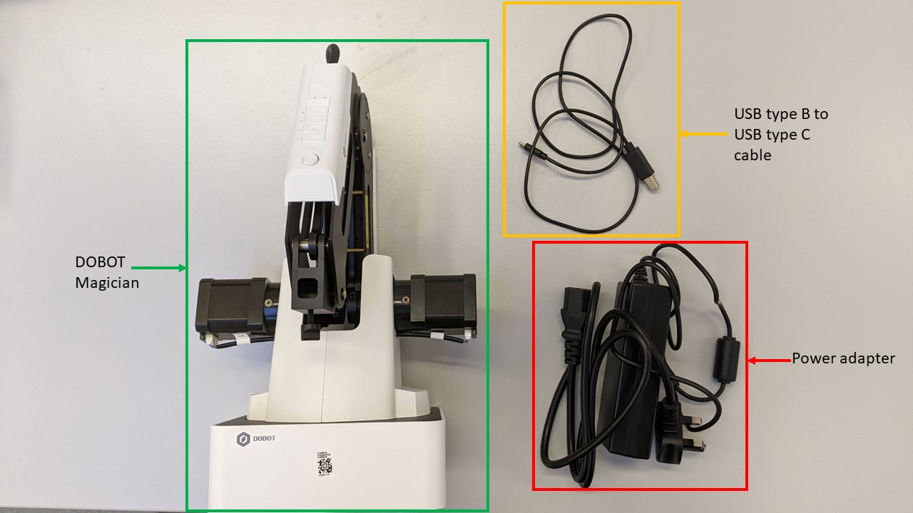
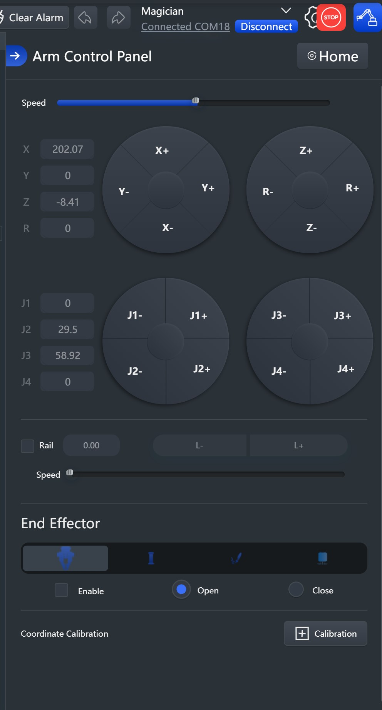
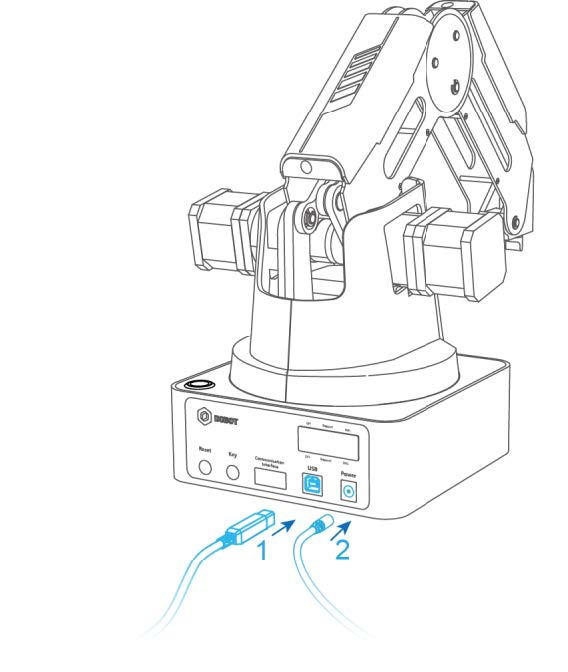
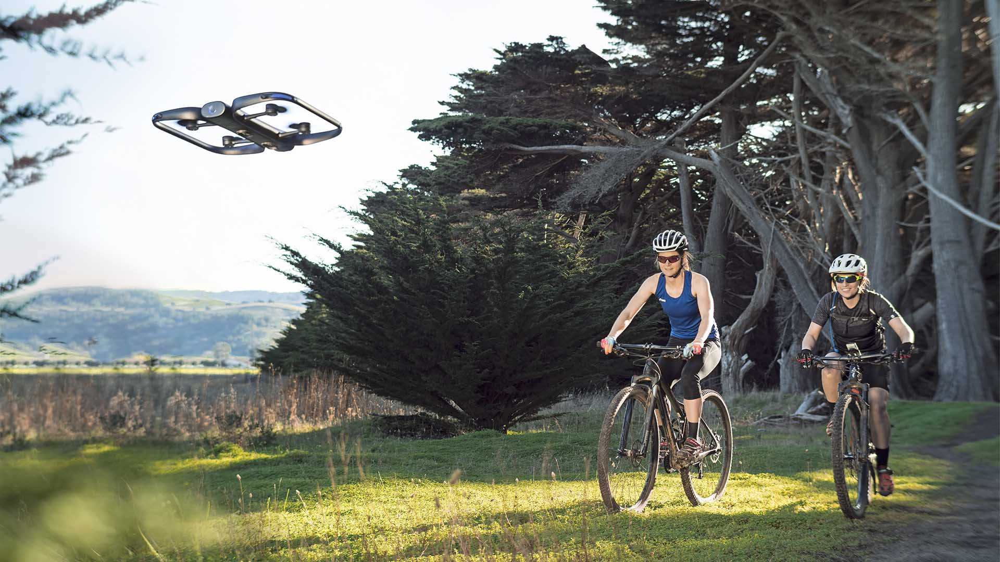

# Sesión 23-24 · Práctica con el brazo robótico (11/11/2026)

> **RA4.** Práctica de **4 h** (dos sesiones seguidas) con el DOBOT Magician: comandos de movimiento y dibujo en el **simulador DobotLab**, y *pick & place* **con ventosa** en el brazo real.

> **Hardware del aula.** El brazo lleva montada **solo la ventosa**: montar y desmontar herramientas cuesta, así que la pinza y el portaminas se trabajan en el simulador.

## Cuaderno de la sesión

Todo el código se trabaja en un único cuaderno **`S23_24_brazo_robotico.ipynb`**:

[Abrir en Colab](https://colab.research.google.com/github/jmperez-profesor/mia/blob/main/docs/bloques/B04_RA4/S23_24_brazo_robotico.ipynb){ .md-button } · [ver en el sitio](S23_24_brazo_robotico.ipynb)

## Qué vas a aprender

| # | Al terminar la sesión serás capaz de… |
|---|---|
| 1 | Usar el **simulador DobotLab** (Blockly y Python) y programar los **comandos de movimiento** (MoveJ, MoveL, Jump, Arc) |
| 2 | Dibujar con **«Escribir/Dibujar»** y aplicar el **protocolo de seguridad** con la ventosa |
| 3 | Implementar una **célula de pick & place con ventosa** y la cinta, y **paletizar** piezas en cuadrícula |
| 4 | Situar las **aplicaciones y tendencias** de la robótica (cobots, humanoides, VLA, ISO 10218) |

## 1. El DOBOT Magician y su API

| Especificación | Valor |
|---|---|
| Ejes | **4** (base, brazo trasero, antebrazo, muñeca) |
| Carga útil | **500 g** |
| Alcance | **320 mm** |
| Repetibilidad | **±0,2 mm** |
| Comunicación | USB / Wi-Fi / Bluetooth |
| Alimentación | 12 V CC |
| Accesorio | Cinta transportadora con fotocélula y sensor de color |

> **Ver el DOBOT en 3D.** [RoboDK for Web](https://robodk.com/3D/es/robot/Dobot-Magician) muestra el modelo 3D del DOBOT en el navegador para inspeccionar sus 4 ejes antes de programarlo.

> **Vídeo (2 min) · conoce el kit.** [«DoBot Magician Robot Arm: Before you buy»](https://www.youtube.com/watch?v=HnGmRvoSBC0) recorre todos los accesorios del DOBOT (pinza, ventosa, portalápices, compresor) y los prueba en un *pick & place*. Míralo antes de tocar el material del aula.



*Montaje básico del DOBOT Magician. Fuente: UAL Creative Computing Institute.*

**Dos formas de programarlo:**

1. **DobotLab** (interfaz web): teach, **Blockly** y editor de script (Python).
2. **Python** con la API oficial (`dType`) o las librerías **`pydobot`** ([Luis Mesas](https://github.com/luismesas/pydobot), `pip install pydobot`) y **`dobot-python`** (Alex Gustafsson, protocolo v1.1.5).



*Panel de control de **DobotLab** (interfaz web). Fuente: UAL Creative Computing Institute.*

> **Simulador DobotLab.** [DobotLab](https://dobotlab.dobot.cc/#/) incluye un **simulador integrado**: entra en **«Basic scene»** para probar movimientos y programas **sin conectar el robot real**. Tiene **Blockly** y **Python**, así que los ejercicios de esta sesión (coordenadas, MoveJ/MoveL/Jump y dibujo) se hacen ahí. Es la herramienta para practicar **mientras un grupo ocupa el brazo real**.

> **Ejemplos de INDA (kit DOBOT).** La carpeta `INDA-Programas-ejemplo/` trae programas de ejemplo para cargar en DobotStudio/DobotLab:
> - **Movimiento:** `Ejercicios/ejercicio3.py` — comandos MoveJ/MoveL/Jump/Arc con cambios de velocidad y aceleración (y su versión `.blockly`).
> - **Ventosa:** `Pick_Place_Ventosa.py` (5 puntos, dos formas de escribirlo), `cinta_ventosa.blockly`, `paletizado_ventosa.blockly`.
> - **Optativos:** `cinta_ventosa_paletizado.blockly` (por color), `cinta_ventosa_despaletizado_bucle.blockly` (devolver a la cinta), `paletizado_parametrizable_ventosa.blockly` (cubo N×N×N) y `cinta_Pinza.py` (clasificación por color + función `sincronizar_codigo`).
> - **No aplicables** (no tenemos el hardware): los de **pinza** y los de **riel móvil**.

> **Definición · Comandos inmediatos vs. encolados.** La API permite ejecutar una orden **ya** (inmediata) o **encolarla** en una cola FIFO (`isQueued=1`). Encolar es lo que permite **construir una secuencia de movimiento** sin esperar: el robot la ejecuta en orden. Es la diferencia entre **teleoperar** (orden a orden) y **programar** (una secuencia completa). Para sincronizar, se puede consultar la pose con `GetPose` hasta que el robot llegue al punto.

```python
# API oficial (dType) — movimiento cartesiano lineal a un punto
dType.SetPTPCoordinateParams(api, 150, 500, 150, 500, isQueued=0)  # vel, ac
dType.SetPTPCmd(api, 2, x, y, z, r, isQueued=1)                    # modo 2 = lineal
dType.SetWAITCmd(api, 500, isQueued=1)                             # esperar 0,5 s
```

```python
# pydobot — misma idea, API de alto nivel
from pydobot import Dobot
robot = Dobot(port="/dev/ttyUSB0")
robot.move_to(250, 0, 50, 0)     # x, y, z, r
robot.suck(True)                  # ventosa: aspirar (soltar: suck(False))
robot.wait(500)
robot.home()
robot.close()
```

> **En `pydobot`:** `move_to(x, y, z, r, wait=True)` espera a que el movimiento termine antes de continuar; con `wait=False` tu script sigue mientras el robot ejecuta. Es el equivalente de alto nivel de encolar (`isQueued=1`) + sondear la pose con `GetPose`: la clave para decidir cuándo **teleoperas** (orden a orden) y cuándo **programas** una secuencia completa.

> **Más información.** En el cuaderno Colab usamos una clase **`BrazoSimulado`** que imita esta API: registra las órdenes, **valida rangos** (X entre 150 y 320 mm, radio ≤ 320 mm, Z dentro de límites) y **dibuja la trayectoria XY** con matplotlib. Es el equivalente en Python al simulador DobotLab: sirve para **verificar el script antes de enviarlo al robot real**.

## 2. Trabajo por parejas (rotación robot ↔ simulador)

Con **un solo brazo** y la **ventosa** montada, el grupo se organiza así:

- **Una pareja en el brazo** (turnos de ~10–15 min): prueba la secuencia de **pick & place con ventosa** y aplica el protocolo de seguridad.
- **El resto en el simulador DobotLab** (o en Colab con `BrazoSimulado`): practica los comandos de movimiento, el dibujo y la lógica de la célula.
- Se **rota** para que todas las parejas pasen por el brazo real.

## 3. Buenas prácticas y seguridad en el aula

Trabajar con un robot real exige un protocolo. No es burocracia: es lo que evita dañar el brazo, la pieza o a un compañero.

> **Vídeo (5 min) · calibración.** [«DOBOT Magician Tutorial – How to Calibrate»](https://www.youtube.com/watch?v=4HtwgLTFIZo) muestra la calibración y el *homing* del brazo antes del primer programa. Véalo el grupo una vez; a partir de ahí, cada pareja calibra al empezar su turno.

- **Antes de ejecutar:** hacer **home**, comprobar que la trayectoria está libre y que **nadie tiene la mano** en el espacio de trabajo.
- **Velocidad reducida** en los primeros ensayos; subirla solo cuando el movimiento es correcto.
- **Sujetar** la mesa y la pieza; una pieza que se mueve arruina la repetibilidad.
- **No forzar los ejes a mano** salvo en modo **teach** con el robot habilitado.
- **Validar siempre** en Colab (`BrazoSimulado`) o en el simulador DobotLab **antes** de cargar el script: el 90 % de los errores (parámetros, rangos, fuera de alcance) se detectan sin tocar el robot.
- **Un solo equipo frente al brazo**; el resto trabaja a distancia. Turnos de 10–15 minutos.
- **Protocolo de entrega:** asunto normalizado (`UD04-BRAZO-EQUIPO3`), `.ipynb` con celdas ejecutadas.

> **Puesta en marcha (LED del DOBOT).** Al encender, el **LED** pasa a **amarillo** y, tras un pitido (~7 s), a **verde** (listo). Si se queda **rojo/ámbar**, el brazo ha tocado un **límite de eje**: mantén pulsado el botón de **desbloqueo** (candado abierto, en el antebrazo) y llévalo a una posición segura.



*Conexión del DOBOT Magician: cable **USB** al ordenador y **adaptador de alimentación**. Fuente: UAL Creative Computing Institute.*

> **Más información.** Este protocolo conecta con la idea de **sistema robotizado** del §6 de la teoría: la seguridad no es una propiedad del brazo, sino del **conjunto** robot + herramienta + entorno + tarea. Es el mismo principio que recoge la ISO 10218:2025 para las aplicaciones colaborativas.

## 4. Actividad · Práctica con el brazo robótico (dos fases)

Una única actividad en **dos fases**, entregada en el cuaderno `S23_24_brazo_robotico.ipynb`. Detalle en [actividades/actividad_brazo_robotico.md](actividades/actividad_brazo_robotico.md).

### Fase 1 · Comandos de movimiento y dibujo (simulador)

Practica los **comandos de movimiento** (MoveJ, MoveL, Jump, Arc) y el **dibujo** con la función «Escribir/Dibujar» del simulador DobotLab (en Blockly o Python), y valida el script con `BrazoSimulado`.

### Fase 2 · Pick & place con ventosa y cinta

> **Vídeo · cinta en marcha.** [«01 instruction: Running the conveyor belt»](https://www.youtube.com/watch?v=qUq_txqwN48) programa la cinta por bloques con el sensor de presencia: la misma célula que vas a montar, vista antes de cablear nada.

> **Vídeo · bucles para paletizar.** [«Using ForLoops in Blockly to Perform Pick and Place Operations»](https://www.youtube.com/watch?v=ECfQhEtGI3w) (John Fuller) muestra un *pick & place* repetido con **bucles `for` en Blockly**: la técnica exacta de la extensión de paletización.

Diseña una célula de pick & place **con ventosa**: coge un objeto de la cinta y déjalo en la zona marcada, con memoria del equipo. **Extensión: paletización** (cuadrícula de filas × columnas) y **optativa: clasificación por color** con el sensor de color.

> **Guía paso a paso.** [Dobot Activity 2: Pick and Place](https://chrisandjimcim.com/dobot-activity-2-pick-and-place/) (Chris and Jim CIM) trae una **ficha descargable en PDF** con la secuencia completa de *pick & place* punto a punto. Es la misma secuencia canónica de esta actividad, aunque está pensada para *teach & playback*: úsala de referencia para ordenar los puntos (inicio → pre-coger → coger → pre-dejar → dejar) y adaptarla a la ventosa.

> **Extensión opcional · clasificación por color.** Si os sobra tiempo, usad el **sensor de color** de la cinta: cubos rojos a una pila, verdes a otra, azules de vuelta a la cinta. Es el cierre perfecto del módulo: **percepción → decisión → actuación** con IA en el bucle. La matriz 3×3 de [Chris and Jim CIM](https://chrisandjimcim.com/category/robotics/dobot/blockly-resources/) es un buen punto de partida (en Blockly, pero la lógica de decisión es la misma en Python).

## 5. Aplicaciones y tendencias (2026)

> **Lectura previa (autónoma).** Esta sección se lee **antes de la sesión**; en clase dedicaremos unos 10 minutos a debatir las tendencias y a conectarlas con la célula que vais a montar.

| Ámbito | Ejemplo | Qué aporta |
|---|---|---|
| **Industria** | Soldadura, paletizado, *pick & place*, control de calidad | Cadencia y precisión constantes |
| **Salud** | Cirugía por telemanipulación (da Vinci), rehabilitación | Precisión milimétrica, menos invasión |
| **Logística** | AMR de almacén (Amazon Robotics, MiR) | Menos tiempo de desplazamiento |
| **Agricultura** | Drones de monitorización y riego de precisión | Menos coste e impacto ambiental |
| **Exploración** | Rovers y drones (Marte, inspección de infraestructuras) | Acceso a entornos peligrosos |



**Tendencias 2026:**

- **Cobots** en crecimiento: el criterio de compra ya no es solo «cuántos kilos», sino **facilidad para integrar visión y ROS 2**.
- **Humanoides** en pilotos de logística (Figure, Agility, Unitree); aún caros frente a un AMR. En 2025 solo se vendieron **~7.000** para uso industrial/profesional (IFR): la «fiebre» inicial se está enfriando.
- ***Foundation models* para robótica (VLA):** modelos como RT-2, OpenVLA, π0 o GR00T prometen «aprende la tarea viéndome hacerla», pero están en fase de investigación.
- **Sim-to-real:** entrenar en simulación (Isaac Lab, MuJoCo) y transferir al robot real, con datos sintéticos y *domain randomization*.
- **Seguridad y normativa:** la **ISO 10218:2025** absorbe los límites biomecánicos de la ISO/TS 15066 y añade ciberseguridad industrial; el **AI Act** clasifica como **alto riesgo** los componentes de seguridad y la maquinaria con IA.

> **Más información.** Para el montaje de una célula real se usan buses deterministas (**PROFINET**, **EtherCAT**) entre PLC y robot, y **OPC UA** o **MQTT** para publicar telemetría al MES y al **gemelo digital**, que anticipa fallos (fatiga de reductoras) antes de que paren la línea.

## Puntos clave

- El DOBOT tiene **4 ejes**, 500 g de carga, 320 mm de alcance y ±0,2 mm de repetibilidad; en el aula solo se monta la **ventosa**.
- **Encolar** (`isQueued=1`) construye una secuencia FIFO; es la base de **programar** frente a **teleoperar**. En `pydobot`, `wait=True` es su equivalente de alto nivel.
- El **simulador DobotLab** (Blockly/Python) y `BrazoSimulado` permiten **practicar sin el brazo real** mientras un grupo lo ocupa.
- La **célula** completa (robot + cinta + sensor + seguridad) es lo que se diseña, no solo el brazo. El **paletizado** repite el pick & place en una **cuadrícula** con bucles.
- Tendencias: **cobots**, **humanoides**, *foundation models* (VLA), **sim-to-real** y la **ISO 10218:2025**.
