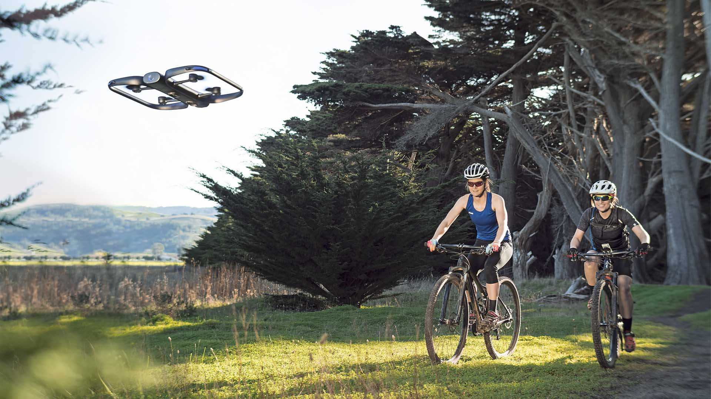

# Sesión 24 · Brazo robótico 2 (11/11/2026)

> **RA4.** Segunda sesión práctica: misión de pick & place **con la ventosa** y la cinta, cerrando con paletización, aplicaciones y tendencias.

## Qué vas a aprender

| # | Al terminar la sesión serás capaz de… |
|---|---|
| 1 | Implementar una **célula de pick & place con ventosa** y la cinta, y **paletizar** piezas en cuadrícula |
| 2 | Justificar por qué se usa la **ventosa** (y cuándo convendría una pinza) |
| 3 | Situar las **aplicaciones y tendencias** de la robótica (cobots, humanoides, VLA, ISO 10218) |

## 9. Aplicaciones actuales y tendencias (2026)

> **Lectura previa (autónoma).** Esta sección se lee **antes de la sesión**; en clase dedicaremos unos 10 minutos a debatir las tendencias y a conectarlas con la célula que vais a montar.

| Ámbito | Ejemplo | Qué aporta |
|---|---|---|
| **Industria** | Soldadura, paletizado, *pick & place*, control de calidad | Cadencia y precisión constantes |
| **Salud** | Cirugía por telemanipulación (da Vinci), rehabilitación | Precisión milimétrica, menos invasión |
| **Logística** | AMR de almacén (Amazon Robotics, MiR) | Menos tiempo de desplazamiento |
| **Agricultura** | Drones de monitorización y riego de precisión | Menos coste e impacto ambiental |
| **Exploración** | Rovers y drones (Marte, inspección de infraestructuras) | Acceso a entornos peligrosos |

**Tendencias 2026:**

- **Cobots** en crecimiento: el criterio de compra ya no es solo «cuántos kilos», sino **facilidad para integrar visión y ROS 2**.
- **Humanoides** en pilotos de logística (Figure, Agility, Unitree); aún caros frente a un AMR. En 2025 solo se vendieron **~7.000** para uso industrial/profesional (IFR): la «fiebre» inicial se está enfriando.
- ***Foundation models* para robótica (VLA):** modelos como RT-2, OpenVLA, π0 o GR00T prometen «aprende la tarea viéndome hacerla», pero están en fase de investigación.
- **Sim-to-real:** entrenar en simulación (Isaac Lab, MuJoCo) y transferir al robot real, con datos sintéticos y *domain randomization*.
- **Seguridad y normativa:** la **ISO 10218:2025** absorbe los límites biomecánicos de la ISO/TS 15066 y añade ciberseguridad industrial; el **AI Act** clasifica como **alto riesgo** los componentes de seguridad y la maquinaria con IA.

> **Más información.** Para el montaje de una célula real se usan buses deterministas (**PROFINET**, **EtherCAT**) entre PLC y robot, y **OPC UA** o **MQTT** para publicar telemetría al MES y al **gemelo digital**, que anticipa fallos (fatiga de reductoras) antes de que paren la línea.

## Actividad 3 · Pick & place con ventosa y cinta (presencial + autónomo)

> **Vídeo · cinta en marcha.** [«01 instruction: Running the conveyor belt»](https://www.youtube.com/watch?v=qUq_txqwN48) programa la cinta por bloques con el sensor de presencia: la misma célula que vas a montar, vista antes de cablear nada.

> **Vídeo · bucles para paletizar.** [«Using ForLoops in Blockly to Perform Pick and Place Operations»](https://www.youtube.com/watch?v=ECfQhEtGI3w) (John Fuller) muestra un *pick & place* repetido con **bucles `for` en Blockly**: la técnica exacta de la extensión de paletización (posiciones calculadas con bucles anidados, no puntos enseñados a mano).

> **Simulador DobotLab.** Recuerda que [DobotLab](https://dobotlab.dobot.cc/#/) (escena de *pick & place*) te permite **ensayar la célula completa sin hardware**: define las posiciones de coger/dejar y prueba la lógica de bucles antes de ocupar tu turno en el brazo real.

Diseña una célula de pick & place **con ventosa**: coge un objeto de la cinta y déjalo en la zona marcada, con memoria del equipo. **Extensión: paletización** (cuadrícula de filas × columnas) y **optativa: clasificación por color** con el sensor de color. Cuaderno [S23_24_brazo_robotico.ipynb](S23_24_brazo_robotico.ipynb). Detalle en [actividades/act3_pick_place.md](actividades/act3_pick_place.md).

> **Guía paso a paso.** [Dobot Activity 2: Pick and Place](https://chrisandjimcim.com/dobot-activity-2-pick-and-place/) (Chris and Jim CIM) trae una **ficha descargable en PDF** con la secuencia completa de *pick & place* punto a punto. Es la misma secuencia canónica de esta actividad, aunque está pensada para *teach & playback*: úsala de referencia para ordenar los puntos (inicio → pre-coger → coger → pre-dejar → dejar) y adaptarla a la ventosa.

> **Ejemplos de INDA (kit DOBOT).** La carpeta `INDA-Programas-ejemplo/` trae programas de ejemplo para cargar en DobotStudio/DobotLab:
> - **Core:** `Pick_Place_Ventosa.py` (pick & place con ventosa, 5 puntos y dos formas de escribirlo), `cinta_ventosa.blockly` (cinta + ventosa) y `paletizado_ventosa.blockly` (paletizado en columnas).
> - **Optativos:** `cinta_ventosa_paletizado.blockly` (paletizado **por color**), `cinta_ventosa_despaletizado_bucle.blockly` (paletizar y luego **devolver los bloques a la cinta**), `paletizado_parametrizable_ventosa.blockly` (cubo de **N×N×N**), y `cinta_Pinza.py` (clasificación por color con la función `sincronizar_codigo`, aunque use pinza).
> - **No aplicables** (no tenemos el hardware): los de **pinza** (`maderitas_pinza`, `Pick_Place_Gripper`) y los de **riel móvil** (`Pick_Place_riel`).

> **Extensión opcional · clasificación por color.** Si os sobra tiempo, usad el **sensor de color** de la cinta: cubos rojos a una pila, verdes a otra, azules de vuelta a la cinta. Es el cierre perfecto del módulo: **percepción → decisión → actuación** con IA en el bucle. La matriz 3×3 de [Chris and Jim CIM](https://chrisandjimcim.com/category/robotics/dobot/blockly-resources/) es un buen punto de partida (en Blockly, pero la lógica de decisión es la misma en Python).

> **Ver el DOBOT en 3D.** [RoboDK for Web](https://robodk.com/3D/es/robot/Dobot-Magician) para inspeccionar el brazo y sus ejes antes de montar la célula.

## Puntos clave

- La **célula** completa (robot + cinta + sensor + seguridad) es lo que se diseña, no solo el brazo.
- La **ventosa** aspira superficies lisas y no porosas; la pinza agarra rígidos, pero en el aula solo se monta la ventosa.
- El **paletizado** repite el pick & place en una **cuadrícula**, parametrizando las posiciones con bucles.
- Tendencias: **cobots**, **humanoides**, *foundation models* (VLA), **sim-to-real** y la **ISO 10218:2025**.
