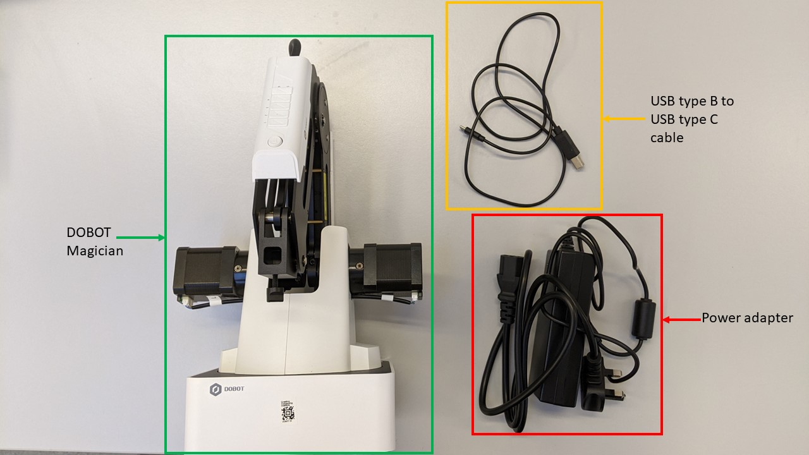
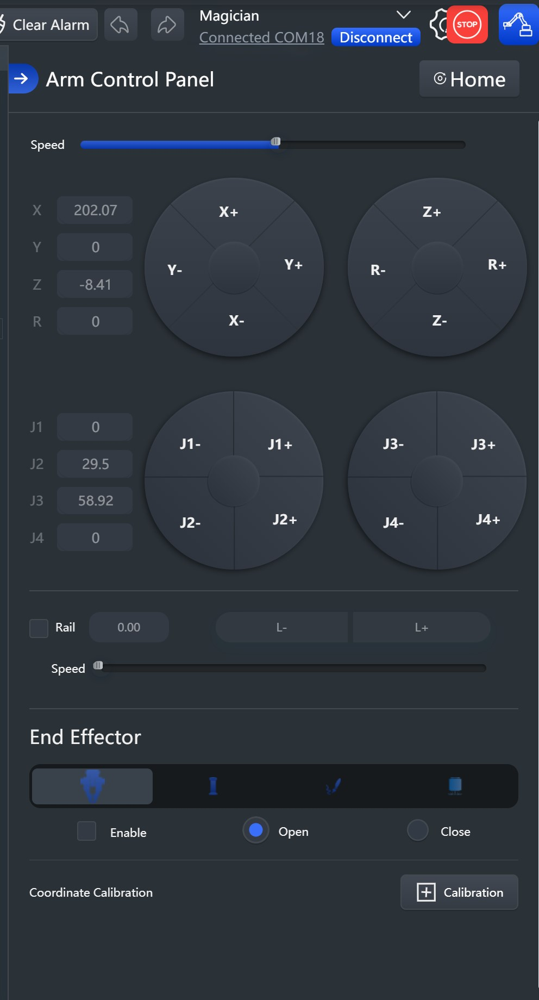
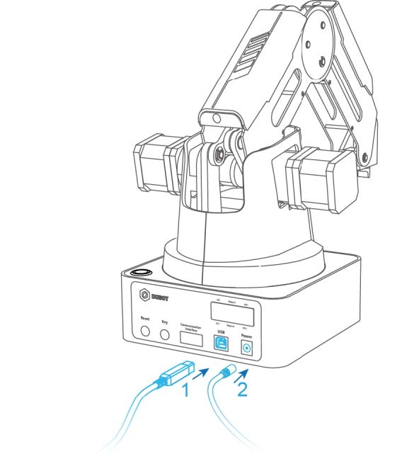

# Sesión 25 · Brazo robótico 1 (11/11/2026)

> **RA4.** Primera sesión práctica con el DOBOT Magician: del guiado (teach) al código, midiendo el espacio de trabajo y resolviendo el reto de dibujo.

## Qué vas a aprender

| # | Al terminar la sesión serás capaz de… |
|---|---|
| 1 | Conocer el **DOBOT Magician** y su **API** (comandos inmediatos vs. encolados) |
| 2 | Pasar del **teach** a la **programación** con `pydobot` / `dType` |
| 3 | Aplicar el **protocolo de seguridad** en el aula |
| 4 | Validar un script con **`BrazoSimulado`** antes de ejecutarlo en el robot |

## 8. El DOBOT Magician y su API

| Especificación | Valor |
|---|---|
| Ejes | **4** (base, brazo trasero, antebrazo, muñeca) |
| Carga útil | **500 g** |
| Alcance | **320 mm** |
| Repetibilidad | **±0,2 mm** |
| Comunicación | USB / Wi-Fi / Bluetooth |
| Alimentación | 12 V CC |
| Accesorio | Cinta transportadora con fotocélula y sensor de color |

> **Ver el DOBOT en 3D.** [RoboDK for Web](https://robodk.com/3D/es/robot/Dobot-Magician) muestra el modelo 3D del DOBOT en el navegador para inspeccionar sus 4 ejes antes de programarlo.



*Montaje básico del DOBOT Magician. Fuente: UAL Creative Computing Institute.*

**Dos formas de programarlo:**

1. **DobotStudio / DobotLab** (interfaz gráfica): teach, Blockly y editor de script.
2. **Python** con la API oficial (`dType`) o las librerías **`pydobot`** (Luis Mesas) y **`dobot-python`** (Alex Gustafsson, protocolo v1.1.5).



*Panel de control de **DobotLab** (interfaz web). Fuente: UAL Creative Computing Institute.*

> **Simulador DobotLab.** [DobotLab](https://dobotlab.dobot.cc/#/) incluye un **simulador integrado**: entra en **«Basic scene»** para probar movimientos y programas **sin conectar el robot real**. Sirve para practicar los comandos (MoveJ, MoveL, Jump) y las escenas de pick & place antes de usar el brazo del aula.

> **Definición · Comandos inmediatos vs. encolados.** La API permite ejecutar una orden **ya** (inmediata) o **encolarla** en una cola FIFO (`isQueued=1`). Encolar es lo que permite **construir una secuencia de movimiento** sin esperar: el robot la ejecuta en orden. Es la diferencia entre **teleoperar** (orden a orden) y **programar** (una secuencia completa). Para sincronizar, se puede consultar la pose con `GetPose` hasta que el robot llegue al punto.

```python
# API oficial (dType) — movimiento cartesiano lineal a un punto
dType.SetPTPCoordinateParams(api, 150, 500, 150, 500, isQueued=0)  # vel, ac
dType.SetPTPCmd(api, 2, x, y, z, r, isQueued=1)                    # modo 2 = lineal
dType.SetWAITCmd(api, 500, isQueued=1)                             # esperar 0,5 s
```

```python
# pydobot — misma idea, API de alto nivel
from pydobot import Dobot
robot = Dobot(port="/dev/ttyUSB0")
robot.move_to(250, 0, 50, 0)     # x, y, z, r
robot.gripper(close=False)        # abrir pinza (ventosa: robot.suck(True))
robot.wait(500)
robot.home()
robot.close()
```

> **Más información.** En el cuaderno Colab usamos una clase **`BrazoSimulado`** que imita esta API: registra las órdenes, **valida rangos** (X entre 150 y 320 mm, radio ≤ 320 mm, Z dentro de límites) y **dibuja la trayectoria XY** con matplotlib. Así el equipo **verifica su dibujo antes de enviarlo al robot real**, sin hardware y sin instalar simuladores 3D.

## 10. Buenas prácticas y seguridad en el aula

Trabajar con un robot real exige un protocolo. No es burocracia: es lo que evita dañar el brazo, la pieza o a un compañero.

- **Antes de ejecutar:** hacer **home**, comprobar que la trayectoria está libre y que **nadie tiene la mano** en el espacio de trabajo.
- **Velocidad reducida** en los primeros ensayos; subirla solo cuando el movimiento es correcto.
- **Sujetar** la mesa y la pieza; una pieza que se mueve arruina la repetibilidad.
- **No forzar los ejes a mano** salvo en modo **teach** con el robot habilitado.
- **Validar siempre en Colab** con `BrazoSimulado` antes de cargar el script: el 90 % de los errores (parámetros, rangos, fuera de alcance) se detectan sin tocar el robot.
- **Un solo equipo frente al brazo**; el resto trabaja a distancia. Turnos de 10-15 minutos.
- **Protocolo de entrega:** asunto normalizado (`UD04-S2-EQUIPO3-reto_dibujo`), `.ipynb` con celdas ejecutadas.

> **Puesta en marcha (LED del DOBOT).** Al encender, el **LED** pasa a **amarillo** y, tras un pitido (~7 s), a **verde** (listo). Si se queda **rojo/ámbar**, el brazo ha tocado un **límite de eje**: mantén pulsado el botón de **desbloqueo** (candado abierto, en el antebrazo) y llévalo a una posición segura.



*Conexión del DOBOT Magician: cable **USB** al ordenador y **adaptador de alimentación**. Fuente: UAL Creative Computing Institute.*

> **Más información.** Este protocolo conecta con la idea de **sistema robotizado** del §6: la seguridad no es una propiedad del brazo, sino del **conjunto** robot + herramienta + entorno + tarea. Es el mismo principio que recoge la ISO 10218:2025 para las aplicaciones colaborativas.

## Actividad 2 · Reto de dibujo (presencial + autónomo)

Del guiado al código: escribe un script que dibuje una figura con el **portaminas**, valídalo sin hardware y ejecútalo en el brazo. Cuaderno [UD04_reto_dibujo_plantilla.ipynb](colab/UD04_reto_dibujo_plantilla.ipynb). Detalle en [actividades/act2_reto_dibujo.md](actividades/act2_reto_dibujo.md).

## Puntos clave

- El DOBOT tiene **4 ejes**, 500 g de carga, 320 mm de alcance y ±0,2 mm de repetibilidad.
- **Encolar** (`isQueued=1`) construye una secuencia FIFO; es la base de **programar** frente a **teleoperar**.
- Antes de ejecutar: **home**, trayectoria libre, velocidad reducida y **validar en Colab** con `BrazoSimulado`.
