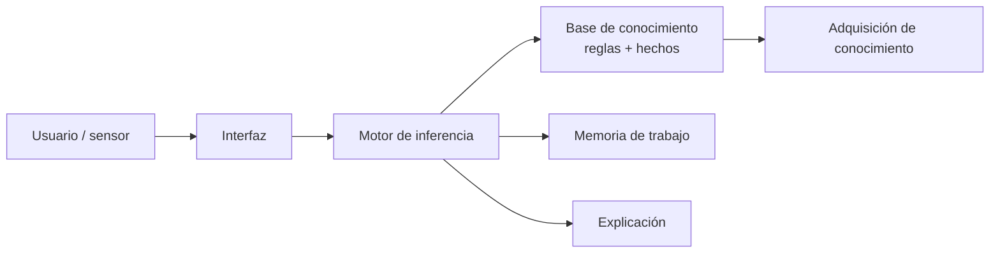
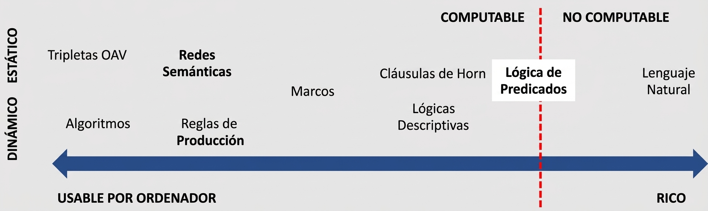
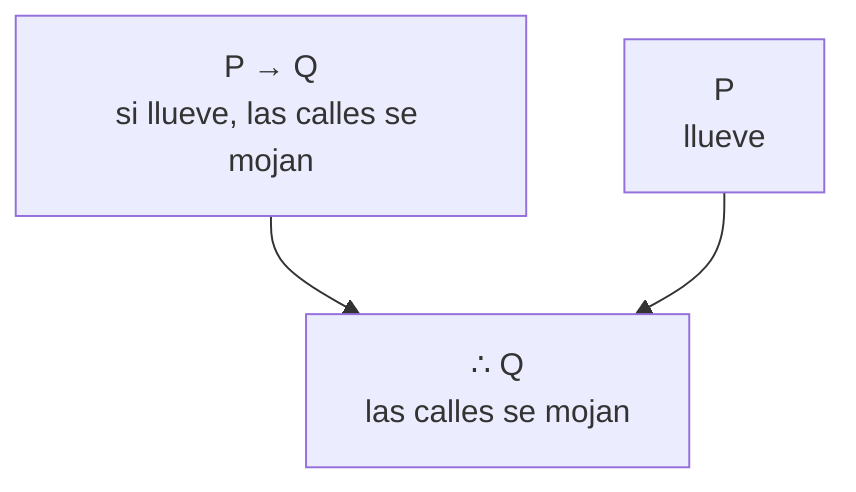
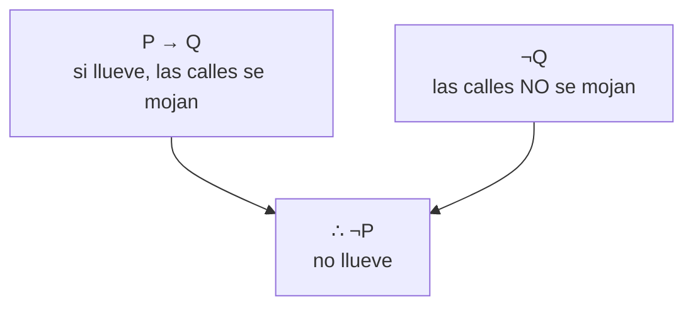
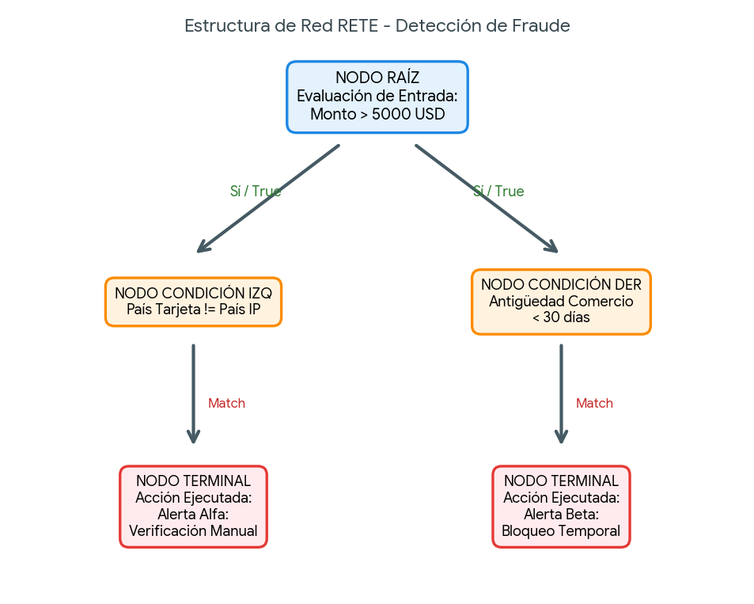
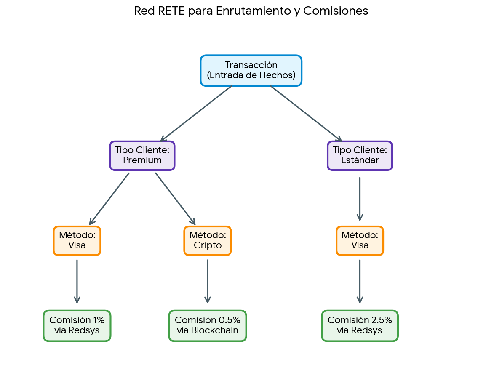

# Sesión 9 · Sistemas expertos (19/10/2026)

> **RA5.** Primera de las tres sesiones sobre sistemas expertos y motores de reglas. Hilo conductor de las tres: **Pagarium**, una pasarela de pagos que decide sobre transacciones.
>
> **Criterios de evaluación (CE):** RA5-a (dinámica y estructuras elementales de los sistemas expertos) y RA5-c (cómo influye la variación de las características en su dinámica).

## Cuaderno de la sesión

El código se trabaja en el cuaderno **`sesion09_sistemas_expertos.ipynb`**:

[Abrir en Colab](https://colab.research.google.com/github/jmperez-profesor/mia/blob/main/docs/bloques/B05_RA5/sesion09_sistemas_expertos.ipynb){ .md-button } · [ver en el sitio](sesion09_sistemas_expertos.ipynb)

## Qué vas a aprender

| # | Al terminar la sesión serás capaz de… |
|---|---|
| 1 | Situar el conocimiento en la jerarquía **DIKW** y describir la **anatomía** de un sistema experto |
| 2 | Diferenciar las **estructuras de representación** del conocimiento (reglas, marcos, lógica, ontologías…) |
| 3 | Explicar el **ciclo de ejecución** (reconocer-resolver-actuar) y el **encadenamiento** hacia delante/atrás |
| 4 | Construir y ejecutar un sistema experto con `experta` y con `clipspy` (CLIPS) |
| 5 | Explicar por qué un motor industrial usa **RETE/PHREAK** y no un simple `for` |

## El caso: Pagarium

Toda la sesión gira en torno a **Pagarium**, una **pasarela de pagos** (como Stripe o Redsys) que procesa transacciones de tiendas online. Cada pago que llega trae unos **hechos**:

| Hecho | Qué es | Ejemplo |
|---|---|---|
| `importe` | Cantidad de la operación, en euros | 200 |
| `antiguedad_meses` | Meses que el comercio lleva con Pagarium | 10 |
| `n_intentos` | Reintentos de pago que lleva el cliente | 5 |

El trabajo de Pagarium es **decidir, con reglas, si aprueba, revisa o rechaza** cada pago. Por ejemplo:

- importe pequeño y pocos reintentos → **aprobar**;
- demasiados reintentos → **rechazar** (puede ser un fraude).

A lo largo de la sesión iremos construyendo ese sistema de reglas: primero un **micro-motor propio** (apartado 7), luego con `experta` (apartado 8) y con CLIPS (apartado 10). En las sesiones siguientes lo llevaremos a motores de negocio (DMN y GoRules ZEN).

## Vídeo · ¿Qué es un sistema experto?

<iframe width="100%" height="380" src="https://www.youtube.com/embed/tCnJtIyWQ6w" title="Sistemas expertos · Inteligencia artificial · Componentes" frameborder="0" allow="accelerometer; autoplay; clipboard-write; encrypted-media; gyroscope; picture-in-picture; web-share" referrerpolicy="strict-origin-when-cross-origin" allowfullscreen></iframe>

[Ver en YouTube](https://www.youtube.com/watch?v=tCnJtIyWQ6w) · *Tecnología 4.0*. Introduce qué es un sistema experto y sus componentes. Míralo como apoyo; lo que importa está explicado abajo.

## 1 · Por qué reglas en 2026

La IA generativa no ha enterrado las reglas: las ha **revalorizado**. En un sistema con LLM, las reglas son la capa que:

- **decide con precisión** lo que el modelo solo estima (importes, límites, elegibilidad);
- **explica** cada decisión (auditoría, *compliance*);
- **acota** al modelo (guardarraíl) para que no ejecute acciones fuera de rango.

Sectores donde las reglas siguen en producción: **banca y seguros** (*scoring*, AML, *underwriting*), **salud** (alertas, dosificación), **industria** (diagnóstico, control), **telecom** (averías), **cloud** (autorización) y **legal** (*compliance*).

## 2 · Del dato al conocimiento: la jerarquía DIKW

Antes de representar el conocimiento hay que distinguirlo de sus vecinos. **¿Qué significa esa frase?**

Significa que, antes de programar el conocimiento dentro de un sistema experto (como `experta`), primero debes entender qué tipo de información tienes entre manos. No toda la información es igual, y confundirlas al diseñar el software provoca que el sistema sea rígido, ineficiente o imposible de mantener.

Para «distinguir el conocimiento de sus vecinos», la informática usa una jerarquía clásica: la **pirámide DIKW** (*Data, Information, Knowledge, Wisdom*).


### Los cuatro vecinos, aplicados a Pagarium

#### 1. El dato (el vecino más básico)

- **Qué es:** una medición o un registro en bruto, sin contexto ni significado por sí solo.
- **En Pagarium:** el número `5000` o las letras `"ES"`. Por sí mismos no dicen nada: ¿`5000` es un ID de usuario o dinero? ¿`"ES"` es España o un error?
- **Ejemplo de temperatura:** «37 ºC».

#### 2. La información (el vecino ordenado)

- **Qué es:** los datos procesados, estructurados y con contexto. Responde al *¿qué?*, *¿quién?* o *¿dónde?*.
- **En Pagarium:** «El monto de la transacción actual es de 5 000 USD y la IP proviene de España (ES)». Ahora el dato tiene campo, nombre y sentido. **Esto es lo que viaja dentro de un `Fact`.**
- **Ejemplo de temperatura:** «La temperatura corporal es 37 ºC».

#### 3. El conocimiento (el protagonista)

- **Qué es:** la mezcla de información con experiencia, reglas de negocio y lógica. Responde al *¿cómo?* y permite tomar decisiones combinando informaciones.
- **En Pagarium:** «Si un usuario Premium realiza una transacción de más de 5 000 USD desde un país diferente al de su tarjeta, la probabilidad de fraude aumenta un 80 % y debe congelarse». No es solo un dato estructurado: es saber qué hacer con esa información basándose en la experiencia. **Esto es lo que se programa en las `Rule`.**
- **Ejemplo de temperatura:** «Si supera 37 ºC, hay fiebre».

#### 4. La sabiduría (el vecino superior)

- **Qué es:** la comprensión profunda, la intuición y el juicio humano sobre cuándo y cómo aplicar el conocimiento. Responde al *¿por qué?*.
- **En Pagarium:** decidir si las reglas de fraude actuales son éticas, si perjudican al usuario legítimo o si hay que cambiar el modelo de negocio por nuevas leyes internacionales.
- **Ejemplo de temperatura:** «Si hay fiebre, toma paracetamol».

### ¿Por qué es vital distinguirlo antes de representarlo?

Si no haces esta distinción antes de escribir código:

1. **Tratarás el conocimiento como si fuera simple información:** programarás reglas complejas con miles de `if/else` planos en una base de datos, creando código espagueti imposible de actualizar.
2. **Tratarás la información como si fuera conocimiento:** sobrecargarás el motor de inferencia (la red RETE) con reglas innecesarias para cosas que se resolverían con una simple consulta de base de datos relacional (como buscar el nombre de un cliente).

!!! important "La distinción clave"
    Un sistema experto no almacena datos ni información: almacena **conocimiento** (reglas) y, en los más avanzados, un poco de **sabiduría** (metarreglas que deciden cuándo aplicar otras reglas). Aísla la lógica pura de decisión (conocimiento) de los meros datos estructurados (información) antes de modelar tus reglas y hechos.

## 3 · Anatomía de un sistema experto

Un **sistema experto** es un programa de IA que **emula el razonamiento de un experto humano** en un dominio concreto: codifica su conocimiento en una **base de conocimiento** y usa un **motor de inferencia** para aplicarlo a los hechos del problema. Fueron muy populares en los años 70-80 y se consideran los primeros sistemas de IA con utilidad práctica real.



| Componente | Función |
|---|---|
| **Base de conocimiento** | Reglas y hechos del dominio, formalizados por el **ingeniero de conocimiento** junto al experto |
| **Memoria de trabajo** | Hechos actuales: los que aporta el usuario o los sensores, más los deducidos |
| **Motor de inferencia** | Evalúa qué reglas se cumplen, resuelve conflictos y ejecuta (ciclo reconocer-resolver-actuar) |
| **Explicación** | Justifica el «por qué» y el «cómo» de una conclusión (su gran ventaja frente al ML) |
| **Adquisición** | Capturar el conocimiento del experto: el famoso *bottleneck* (cuellos de botella), la parte más lenta |

!!! important "La explicación marca la diferencia"
    La capacidad de **explicar** su razonamiento es lo que distingue a un sistema experto de un modelo de ML: en dominios regulados (medicina, finanzas) la justificación es obligatoria. **MYCIN** fue el pionero, mostrando las reglas que usó.

<iframe width="100%" height="380" src="https://www.youtube.com/embed/nbDnejsIUso" title="Sistema experto MYCIN - Precursores Inteligencia Artificial" frameborder="0" allow="accelerometer; autoplay; clipboard-write; encrypted-media; gyroscope; picture-in-picture; web-share" referrerpolicy="strict-origin-when-cross-origin" allowfullscreen></iframe>

[Ver en YouTube](https://www.youtube.com/watch?v=nbDnejsIUso) · *Omar Steeven Calderon*. MYCIN, el sistema experto pionero de la explicabilidad (en español, 5:43).

## 4 · Representar el conocimiento

Representar el conocimiento es hacerlo **entendible** para la máquina, **útil** para resolver problemas y **eficiente** de procesar. Las representaciones forman un **continuo**: en un extremo las simples (algoritmos) y en el otro las flexibles (texto natural), que una máquina no puede usar directamente.

**Espectro del poder expresivo en los modelos de representación del conocimiento:**


Haciendo puente con la respuesta anterior sobre **"distinguir el conocimiento de sus vecinos"**, este gráfico ilustra las herramientas que usamos para representar ese conocimiento informáticamente:

1. **A la izquierda de la línea (Menor poder expresivo):**
Aquí se sitúan los formatos más básicos (como las bases de datos relacionales tradicionales o la *Lógica Proposicional*). Son excelentes para almacenar datos e información simples (ej. *"El monto es 5000"*), pero son incapaces de generalizar o expresar relaciones complejas entre objetos de forma natural.
2. **La barrera roja ("Lógica de predicados")**:
La **Lógica de Predicados** marca un salto cuántico. Al introducir variables, constantes y cuantificadores (como *"Para todo X..."* o *"Existe un Y..."*), permite a un **sistema experto** modelar el **conocimiento real del mundo**. Es la herramienta matemática que permite escribir reglas abstractas como la que vimos para Pagarium: *"Si un cliente X realiza un pago Y, y el país de X es diferente al país de la IP de Y..."*.
3. **A la derecha de la línea (Mayor poder expresivo)**:
Hacia el extremo derecho se ubican lenguajes lógicos aún más avanzados (como la Lógica de Segundo Orden o las Lógicas de Descripción), capaces de modelar conceptos sobre conceptos, incertidumbre o propiedades matemáticas complejas, aunque a costa de requerir un poder de cómputo inmenso.

💡 En resumen

La imagen ilustra que la **Lógica de Predicados** es la línea divisoria que nos permite pasar de computar simples *"datos estructurados aislados"* a construir un verdadero **motor de inferencia capaz de razonar** y conectar conceptos de forma inteligente.


| Representación | Estructura | Inferencia | Ventaja | Límite |
|---|---|---|---|---|
| **Pares atributo-valor** | Tripletes objeto-atributo-valor | Recorrido y coincidencia | Muy simple de construir | Poco expresiva para relaciones complejas |
| **Reglas de producción** | `SI … ENTONCES …` | Encadenamiento + resolución de conflictos | Modular, legible, explicable | Difícil modelar jerarquías; lenta con bases grandes |
| **Jerarquías** | Árbol de conceptos | Recorrido, herencia | Natural para taxonomías | Rígida si un concepto cuelga de varias ramas |
| **Marcos (frames)** | Registros con ranuras y valores por defecto | Herencia de clases | Conocimiento estructurado | Conflicto con herencia múltiple |
| **Lógica formal** | Predicados de primer orden | Resolución, deducción | Rigor matemático | Explosión combinatoria |
| **Redes semánticas** | Grafo de conceptos y relaciones | Búsqueda en grafos | Intuitiva para relaciones | Semántica ambigua |
| **Ontologías** | Clases, propiedades, axiomas (OWL) | Razonadores (Pellet, HermiT) | Interoperabilidad | Curva de aprendizaje alta |

**Ejemplo de un red semántica:**


!!! tip "Regla práctica de esta sesión"
    Usamos sobre todo **reglas de producción** (con `experta` y `clipspy`). Ontologías, redes semánticas, frames y lógica formal se tratan a nivel conceptual.

## 5 · El ciclo de ejecución y el encadenamiento

El motor de inferencia opera en un **bucle reconocer-actuar**:

1. **Reconocer (match):** se comparan los hechos de la memoria de trabajo con las condiciones (LHS) de las reglas; las que encajan van a la **agenda**.
2. **Resolver (resolve):** si hay varias activas, se elige una según la estrategia (salience, recency, especificidad).
3. **Actuar (act):** se ejecuta el consecuente (RHS), que declara/modifica/retira hechos, y el ciclo se repite.

**Encadenamiento:**

- **Hacia delante (forward, data-driven):** de los hechos a las conclusiones → control, monitorización.
- **Hacia atrás (backward, goal-driven):** de una meta a los hechos que la sustentan → diagnóstico (MYCIN, Prolog).

[](https://prezi.com/fvw2aokvct7r/encadenamiento-hacia-adelante-y-hacia-atras/)

> Presentación del concepto (Prezi): [Encadenamiento hacia delante y hacia atrás](https://prezi.com/fvw2aokvct7r/encadenamiento-hacia-adelante-y-hacia-atras/).

### Modus Ponens y Modus Tollens

El encadenamiento se apoya en **dos reglas de inferencia** de la lógica proposicional. En ambas, partimos de una implicación *P* → *Q* («si *P*, entonces *Q*»):

**Modus Ponens** (en latín, «el modo que afirma»): *si P implica Q, y P es verdad, entonces Q es verdad*. Afirmamos el antecedente (*P*) y concluimos el consecuente (*Q*).



**Modus Tollens** (en latín, «el modo que niega»): *si P implica Q, y Q no es cierto, entonces P no es cierto*. Negamos el consecuente (*¬Q*) y concluimos la negación del antecedente (*¬P*).



#### El ejemplo típico: la lluvia

Tomamos *P* = «llueve» y *Q* = «las calles se mojan»:

- **Modus Ponens.** «Si llueve, las calles se mojan. Ha llovido, por tanto las calles se mojan.» Válido: de *P* deducimos *Q*.
- **Modus Tollens.** «Si llueve, las calles se mojan. Las calles **no** están mojadas, por tanto **no** ha llovido.» Válido: de *¬Q* deducimos *¬P*.

!!! warning "Cuidado: la falacia de afirmar el consecuente"
    «Las calles están mojadas, por tanto ha llovido» es **incorrecto**. Ahí afirmas *Q* y concluyes *P*, y eso no se sigue lógicamente: las calles pueden estar mojadas por un camión de riego o por una avería. Las dos únicas formas válidas son el **Modus Ponens** (*P* → *Q*) y el **Modus Tollens** (*¬Q* → *¬P*).

#### Ejemplo de mecánica

Tomamos *P* = «la batería está descargada» y *Q* = «el coche no arranca»:

- **Modus Ponens.** «Si la batería está descargada, el coche no arranca. La batería está descargada, por tanto el coche no arranca.»
- **Modus Tollens.** «Si la batería está descargada, el coche no arranca. El coche **sí** arranca, por tanto la batería **no** está descargada.» (Es el razonamiento de un mecánico: descarta la batería cuando el coche arranca.)

#### Ejemplo médico (al estilo MYCIN)

Tomamos *P* = «el paciente tiene meningitis bacteriana» y *Q* = «presenta rigidez de nuca»:

- **Modus Ponens.** «Si hay meningitis bacteriana, hay rigidez de nuca. El paciente tiene meningitis, por tanto presenta rigidez de nuca.»
- **Modus Tollens.** «Si hay meningitis bacteriana, hay rigidez de nuca. El paciente **no** presenta rigidez de nuca, por tanto **no** tiene meningitis bacteriana.» (El médico la descarta como diagnóstico.)

#### Relación con el encadenamiento

- **Hacia delante** aplica **Modus Ponens** repetidamente: parte de los hechos (*P*) y encadena hasta la conclusión. Con Pagarium: *P* = «el pago lleva 4 o más reintentos», *Q* = «rechazar el pago»; si sabemos *P* (5 reintentos), deducimos *Q* (rechazar).
- **Hacia atrás** aplica **Modus Tollens** (o busca qué *P* sustentaría un *Q*): parte de la meta y comprueba qué hechos la sustentan o la descartan. Con Pagarium: si *Q* **no** es cierto (el pago **no** se rechazó), concluimos que *P* tampoco (no había 4 reintentos).

## 6 · Incertidumbre: factores de certeza (MYCIN)

MYCIN introdujo los **factores de certeza (CF)** para razonar con conocimiento parcial: cada regla lleva un CF y la evidencia se **acumula** al encadenar.

!!! example "Combinar factores de certeza"
    «SI fiebre alta ENTONCES sospecha de meningitis **CF 0,6**» y «SI rigidez de nuca ENTONCES sospecha de meningitis **CF 0,4**». MYCIN combina ambos apoyos en una confianza conjunta mayor que cada uno por separado (acumulación de evidencia). Si hay evidencia en contra, se descuenta.

## 7 · Un micro-motor propio (lo construimos paso a paso)

Un motor de reglas es, en esencia, un bucle *match-resolve-act*. Lo construimos **juntos**, pieza a pieza. Al final verás **por qué falla**: dispara todas las reglas que encajan sin elegir, y produce dos decisiones contradictorias.

### Los 4 pasos (en una sola celda)

!!! warning "En Python, una clase se escribe en una sola celda"
    No se puede repartir una clase entre celdas: los métodos van **indentados dentro de ella**. Por eso los 4 pasos van en el **mismo bloque** de código.

!!! tip "Si ejecutas sin completar los TODO"
    Los `# TODO` son el ejercicio: hasta que no los rellenes (y borres el `pass`), el código **dará error** al usarlo (p. ej. `AttributeError: 'MicroMotor' object has no attribute 'traza'`). Es lo esperado.

```python
class MicroMotor:
    # ---------- PASO 1 · los tres almacenes ----------
    def __init__(self):
        # TODO: crea con self (el punto se lee "de este objeto"):
        #   self.hechos = {}   # diccionario para los hechos
        #   self.reglas = []   # lista para las reglas
        #   self.traza  = []   # lista para el orden de disparo
        pass   # borra esta línea cuando completes el TODO

    # ---------- PASO 2 · añadir hechos ----------
    def hecho(self, **h):        # **h recoge las parejas nombre=valor
        # TODO: añade esas parejas al diccionario self.hechos
        #       (pista: self.hechos.update(h))
        pass

    # ---------- PASO 3 · añadir reglas ----------
    def regla(self, nombre, prioridad, condicion, accion):
        # TODO: añade (nombre, prioridad, condicion, accion) a self.reglas
        #       (pista: self.reglas.append((nombre, prioridad, condicion, accion)))
        pass

    # ---------- PASO 4 · el ciclo reconocer-actuar ----------
    def run(self):
        pendientes = True
        # TODO: mientras pendientes sea True:
        #   pon pendientes = False
        #   recorre con for cada (nombre, prioridad, condicion, accion) de self.reglas:
        #     si nombre ya está en self.traza -> continue
        #     si condicion(self.hechos) se cumple:
        #        apunta nombre en self.traza, ejecuta accion(self.hechos), pon pendientes = True
        #   al salir, devuelve self.hechos
        pass
```

### Paso 5 · Crear el motor y probarlo

```python
motor = MicroMotor()
motor.hecho(importe=200, antiguedad_meses=10, n_intentos=5)   # hechos del pago

motor.regla("aprobar_pequena", 10, lambda h: h["importe"] < 500,      # condición: importe < 500
            lambda h: h.update(decision="aprobar"))                  # acción: decide "aprobar"
motor.regla("rechazar_reintentos", 10, lambda h: h["n_intentos"] >= 4,  # condición: reintentos >= 4
            lambda h: h.update(decision="rechazar"))                 # acción: decide "rechazar"

print(motor.run())     # -> {'importe': 200, ..., 'decision': 'rechazar'}  ¡y antes pasó por 'aprobar'!
print(motor.traza)     # -> ['aprobar_pequena', 'rechazar_reintentos']
```

!!! warning "El bug que enseña"
    Al juntar los pasos, el motor dedujo **aprobar** y luego **rechazar** para el mismo pago. Es la puerta al **razonamiento no monótono** (una conclusión invalida otra) y a la **estratificación por `salience`**: sin resolución de conflictos, el resultado depende del orden de las reglas.

## 8 · `experta` con parche (docencia, no producción)

Experta es una librería de Python diseñada para la creación de **sistemas expertos** e inspirada en el lenguaje de programación **CLIPS**.

**🧠 ¿Qué es Experta?** Es una bifurcación (*fork*) de la antigua librería **Pyknow**. Su motor de inferencia funciona bajo el algoritmo **RETE** y permite definir una base de conocimiento mediante reglas y hechos (*Facts*) en Python estructurado.

`experta` (2019, sin mantenimiento) es ideal para **entender** el ciclo de inferencia. En Python 3.10+ necesita el parche de `collections.Mapping`. Antes de escribir reglas, un minuto para los **decoradores**, porque `@DefFacts` y `@Rule` lo son.

### Los decoradores (`@`) en 2 minutos

Un **decorador** es una función que *envuelve* a otra para modificar su comportamiento, y se aplica con `@nombre`. Ejemplo sencillo (adaptado de [El Libro de Python](https://ellibrodepython.com/decoradores-python)):

```python
def mi_decorador(funcion):        # recibe la función a decorar
    def nueva_funcion(a, b):      # la "envuelve"
        print("Antes de llamar")
        c = funcion(a, b)         # llama a la función original
        print("Después de llamar")
        return c
    return nueva_funcion          # devuelve la función envuelta

@mi_decorador                     # aplica el decorador a suma
def suma(a, b):
    return a + b

print(suma(5, 8))
# Antes de llamar
# 13
# Después de llamar
```

Con **parámetros** (por eso `@Rule(...)` y `@DefFacts()` llevan paréntesis): el decorador se llama con argumentos y devuelve el decorador de verdad. En `experta`, `@Rule(...)` marca un método como **regla** del motor y `@DefFacts()` marca el método que devuelve los **hechos iniciales**.

**Dos casos reales:**

- **Registrar en un fichero (`@log`).** Un decorador con parámetros que escribe el resultado de cada función en un fichero. Fíjate en las **tres funciones anidadas**: el decorador recibe `fichero_log`, devuelve otro decorador, que a su vez envuelve la función.

```python
def log(fichero_log):                     # decorador "de fábrica": recibe el nombre del fichero
    def decorador_log(func):              # el decorador de verdad: recibe la función
        def decorador_funcion(*args, **kwargs):       # *args/**kwargs = "cualquier argumento"
            with open(fichero_log, 'a') as f:         # abre el fichero en modo añadir
                output = func(*args, **kwargs)        # llama a la función original
                f.write(f"{output}\n")               # escribe el resultado en el fichero
        return decorador_funcion
    return decorador_log

@log('resultados.log')
def suma(a, b):
    return a + b

suma(10, 30)      # crea (o añade a) resultados.log la línea "40"
```

- **Permitir solo a usuarios autenticados.** Un decorador que ejecuta la función solo si la variable `autenticado` es `True`.

```python
autenticado = True

def requiere_autenticacion(f):
    def funcion_decorada(*args, **kwargs):
        if not autenticado:                          # si no está autenticado
            print("Error. El usuario no se ha autenticado")
        else:
            return f(*args, **kwargs)                # si sí, ejecuta la función
    return funcion_decorada

@requiere_autenticacion
def di_hola():
    print("Hola")

di_hola()          # -> Hola (si autenticado=True) / Error... (si False)
```

> En `experta`, `@Rule(...)` y `@DefFacts()` son decoradores con parámetros como `@log`: el motor los usa para registrar cada método como **regla** o como fuente de **hechos iniciales**.

### Lo construimos paso a paso (en una sola celda)

Igual que el micro-motor: la clase va **en una sola celda**. El parche y los `import` van al principio; completa cada `# TODO`.

```python
%pip install experta

import collections, collections.abc
if not hasattr(collections, "Mapping"):   # parche para Python 3.10+
    collections.Mapping = collections.abc.Mapping
    collections.Iterable = collections.abc.Iterable
    collections.MutableMapping = collections.abc.MutableMapping

from experta import *                     # importa Fact, Rule, KnowledgeEngine...

class Pagarium(KnowledgeEngine):          # hereda el motor de reglas
    # ---------- PASO 2 · los hechos iniciales (@DefFacts) ----------
    @DefFacts()
    def inicio(self):
        # TODO: devuelve el hecho inicial accion="evaluar"
        #       (pista: yield Fact(accion="evaluar"))
        pass

    # ---------- PASO 3 · las reglas (@Rule) ----------
    @Rule(Fact(accion="evaluar"), Fact(importe=P(lambda i: i < 500)),
          Fact(n_intentos=P(lambda n: n < 4)), salience=20)   # salience = prioridad
    def aprobar(self):
        # TODO: declara decision="aprobar" con self.declare(Fact(...))
        pass

    @Rule(Fact(n_intentos=P(lambda n: n >= 4)), salience=30)   # más prioridad
    def rechazar(self):
        # TODO: declara decision="rechazar"
        pass
```

### Ejecutar el motor

```python
motor = Pagarium()
motor.reset()      # crea el motor y lo deja listo
motor.declare(Fact(importe=200, n_intentos=5))   # hechos del pago
motor.run()                            # ejecuta el ciclo de inferencia
print([dict(f) for f in motor.facts.values() if "decision" in f])   # solo hechos con 'decision'
```

!!! warning "Trampa con `experta`"
    Compara por **igualdad**: `Fact(error=lambda e: e > 3)` nunca coincide. Las condiciones van dentro de `P(...)`. Y no uses `self` dentro de `P(...)`: el decorador se evalúa al definir la clase.

## 9 · RETE y PHREAK

El ciclo *match* ingenuo compara todas las reglas con todos los hechos (lento). El **algoritmo RETE** es un método de emparejamiento de patrones extremadamente eficiente, diseñado por **Charles Forgy en 1974**, que usan los motores de inferencia de los sistemas expertos. En lugar de evaluar cada regla una por una cada vez que la información cambia (lo que sería lentísimo), RETE optimiza el proceso.

---

### ⚙️ ¿Cómo funciona?

El secreto de RETE es que **intercambia memoria por velocidad** a través de dos principios clave:

1. **Red de nodos (Grafo dirigido):** Compila el conjunto de reglas en una red de nodos interconectados. Cuando un hecho entra al sistema, viaja a través de esta red. Cada nodo actúa como un filtro que evalúa una condición específica (por ejemplo, *¿el color es rojo?* o *¿la edad es mayor a 18?*).
2. **Memoria de estado (Evita la redundancia):** El algoritmo recuerda qué reglas se cumplieron parcialmente en ciclos anteriores. Si un hecho nuevo entra al sistema, RETE no vuelve a evaluar todo desde cero; solo calcula el impacto del nuevo hecho en la red.

---

### 📊 Sus principales ventajas

* **Estructura en árbol:** Si varias reglas comparten la misma condición inicial, esa condición se evalúa **una sola vez** para todas ellas, ahorrando tiempo de procesamiento.
* **Procesamiento instantáneo:** Está pensado para sistemas donde los hechos cambian constantemente pero las reglas se mantienen estables, permitiendo reaccionar en milisegundos.

Es el motor detrás de herramientas tan famosas en la informática como **CLIPS**, **Drools** y la librería **Experta** de Python.

---

### 🏢 Ejemplos Visuales (Adaptados a la vida real: Pasarela de pagos "Pagarium")

Para entender cómo el algoritmo RETE optimiza la evaluación, imagina que **Pagarium** (nuestra pasarela de pagos) tiene que evaluar miles de transacciones por segundo aplicando reglas de fraude y comisiones. 

En lugar de revisar cada regla desde el principio para cada transacción, RETE compila las reglas en una estructura de árbol por donde "caen" los datos.

#### Ejemplo 1: Red de Detección de Fraude en Tiempo Real

Pagarium necesita evaluar si una transacción es sospechosa mediante dos reglas de negocio:

* **Regla Alerta Alfa:** Si el monto es mayor a \$5,000 y el país de origen no coincide con el de la tarjeta, se requiere verificación manual.
* **Regla Alerta Beta:** Si el monto es mayor a \$5,000 y la cuenta del comercio tiene menos de 30 días de antigüedad, se bloquea el pago temporalmente.

**El beneficio de RETE:** Como ambas reglas comparten la condición del monto (`Monto > 5000`), el algoritmo **evalúa esa condición una sola vez**. Si el monto es menor, el camino se corta de inmediato para ambas reglas.

<figure markdown>
  { width="100%" }
  <figcaption>Red de Detección de Fraude en Tiempo Real - Elaborado por Gemini</figcaption>
</figure>

* **Nodos Raíz / Alfa:** Evalúan condiciones simples de un solo campo (ej. el monto).
* **Nodos de Combinación / Beta:** Evalúan cuando se cumplen múltiples criterios a la vez.

#### Código en Python para el ejemplo 1 (Red de Detección de Fraude) de la pasarela de pagos Pagarium.

Este código define las estructuras de los datos `(Facts)` y las reglas de negocio `(Rules)` para que el algoritmo **RETE** las procese de forma eficiente.

```python
from experta import KnowledgeEngine, Fact, Rule, MATCH, TEST

# 1. Definimos la estructura de una Transacción
class Transaccion(Fact):
    """Información que viaja a través de la pasarela Pagarium"""
    pass

# 2. Definimos el Motor de Inferencia (La Red RETE)
class PagariumFraudEngine(KnowledgeEngine):

    # Regla Alerta Alfa: Monto > 5000 y los países no coinciden
    @Rule(
        Transaccion(
            monto=MATCH.monto,
            pais_tarjeta=MATCH.p_tarjeta,
            pais_ip=MATCH.p_ip
        ),
        # RETE evalúa el monto primero y comparte este filtro con otras reglas
        TEST(lambda monto: monto > 5000),
        TEST(lambda p_tarjeta, p_ip: p_tarjeta != p_ip)
    )
    def alerta_alfa(self):
        print("🚨 [ALERTA ALFA] -> Requiere Verificación Manual: Monto alto y discrepancia de países.")

    # Regla Alerta Beta: Monto > 5000 y comercio nuevo
    @Rule(
        Transaccion(
            monto=MATCH.monto,
            antiguedad_comercio_dias=MATCH.antiguedad
        ),
        # RETE reutiliza la lógica si el monto ya fue evaluado
        TEST(lambda monto: monto > 5000),
        TEST(lambda antiguedad: antiguedad < 30)
    )
    def alerta_beta(self):
        print("⛔ [ALERTA BETA] -> Bloqueo Temporal: Monto alto en un comercio con menos de 30 días.")


# 3. Pruebas del sistema en tiempo real
if __name__ == "__main__":
    # Inicializamos el motor de Pagarium
    engine = PagariumFraudEngine()
    engine.reset()

    print("--- Procesando Transacción 1 (Normal) ---")
    # Esta transacción se descarta de inmediato por el primer nodo RETE (monto bajo)
    engine.declare(Transaccion(monto=100, pais_tarjeta="ES", pais_ip="ES", antiguedad_comercio_dias=120))
    engine.run()

    print("\n--- Procesando Transacción 2 (Sospechosa Alfa) ---")
    # Monto alto y países distintos
    engine.reset()
    engine.declare(Transaccion(monto=6500, pais_tarjeta="US", pais_ip="ES", antiguedad_comercio_dias=90))
    engine.run()

    print("\n--- Procesando Transacción 3 (Sospechosa Beta) ---")
    # Monto alto y comercio muy nuevo
    engine.reset()
    engine.declare(Transaccion(monto=7000, pais_tarjeta="MX", pais_ip="MX", antiguedad_comercio_dias=15))
    engine.run()
```

##### 🔍 Puntos clave de la implementación:

* `Fact` (Hecho): La clase Transaccion actúa como el contenedor de datos que alimenta la red.
* `MATCH` y `TEST`: Se utilizan para enlazar las propiedades de la transacción y aplicar las condiciones lógicas.
* `engine.run()`: Activa el motor de inferencia. Gracias a **RETE**, las reglas no se evalúan de forma secuencial en cada llamada, sino que la transacción se "filtra" instantáneamente por los nodos que corresponden.

---

#### Ejemplo 2: Red de Enrutamiento Inteligente y Comisiones

Pagarium cobra comisiones distintas y elige diferentes proveedores bancarios según el tipo de cliente y el método de pago:

* **Regla Premium-Visa:** Si el cliente es "Premium" y paga con Visa, la comisión es del 1% y se procesa por Redsys.
* **Regla Premium-Crypto:** Si el cliente es "Premium" y paga con Cripto, la comisión es del 0.5% y se procesa por una red Blockchain interna.
* **Regla Estándar-Visa:** Si el cliente es "Estándar" y paga con Visa, la comisión es del 2.5% y se procesa por Redsys.

**El beneficio de RETE:** Aquí la red indexa los caminos. Si llega una transacción de un cliente Premium, el sistema ignora por completo toda la rama de clientes Estándar.

<figure markdown>
  { width="100%" }
  <figcaption>Red de Enrutamiento Inteligente y Comisiones - Elaborado por Gemini</figcaption>
</figure>

#### Código en Python para el ejemplo 2 (Red de Enrutamiento Inteligente y Comisiones) de la pasarela Pagarium.

En este caso, veremos cómo el algoritmo RETE indexa las propiedades para crear ramas separadas. Si el motor detecta que un cliente es `Premium`, la red descarta automáticamente evaluar cualquier condición relacionada con un cliente `Estandar`.

```python
from experta import KnowledgeEngine, Fact, Rule, MATCH

# 1. Definimos la estructura de la transacción
class Pago(Fact):
    """Información del pago a procesar en Pagarium"""
    pass

# 2. Motor de Inferencia para Enrutamiento y Comisiones
class PagariumRoutingEngine(KnowledgeEngine):

    # Regla 1: Cliente Premium - Método Visa
    @Rule(Pago(tipo_cliente="Premium", metodo_pago="Visa", monto=MATCH.monto))
    def premium_visa(self, monto):
        comision = monto * 0.01  # 1%
        print(f"💳 [PREMIUM-VISA] -> Procesando por Redsys. Comisión (1%): ${comision:.2f}")

    # Regla 2: Cliente Premium - Método Cripto
    @Rule(Pago(tipo_cliente="Premium", metodo_pago="Cripto", monto=MATCH.monto))
    def premium_crypto(self, monto):
        comision = monto * 0.005  # 0.5%
        print(f"🪙 [PREMIUM-CRYPTO] -> Procesando por Blockchain. Comisión (0.5%): ${comision:.2f}")

    # Regla 3: Cliente Estándar - Método Visa
    @Rule(Pago(tipo_cliente="Estandar", metodo_pago="Visa", monto=MATCH.monto))
    def estandar_visa(self, monto):
        comision = monto * 0.025  # 2.5%
        print(f"💳 [ESTANDAR-VISA] -> Procesando por Redsys. Comisión (2.5%): ${comision:.2f}")


# 3. Simulación de la Pasarela de Pagos
if __name__ == "__main__":
    engine = PagariumRoutingEngine()

    print("--- Transacción A: Cliente VIP usando Tarjeta ---")
    engine.reset()
    engine.declare(Pago(tipo_cliente="Premium", metodo_pago="Visa", monto=1000))
    engine.run()
    # RETE entra por la rama Premium -> Visa y ejecuta la Regla 1.

    print("\n--- Transacción B: Cliente VIP usando Bitcoin ---")
    engine.reset()
    engine.declare(Pago(tipo_cliente="Premium", metodo_pago="Cripto", monto=2000))
    engine.run()
    # RETE entra por la rama Premium -> Cripto y ejecuta la Regla 2.

    print("\n--- Transacción C: Comercio común usando Tarjeta ---")
    engine.reset()
    engine.declare(Pago(tipo_cliente="Estandar", metodo_pago="Visa", monto=500))
    engine.run()
    # RETE ignora toda la rama Premium desde el primer nodo y se va directo a Estándar -> Visa (Regla 3).
```
#### 🧠 ¿Cómo optimiza RETE este segundo ejemplo?

Cuando declaramos el hecho `Pago(tipo_cliente="Premium", ...)`, la red **RETE** funciona como un árbol de decisiones indexado:
1. Evalúa el primer nodo de propiedad: `tipo_cliente`.
2. Al coincidir con `"Premium"`, el motor desactiva por completo el nodo que evalúa si es `"Estandar"`.
3. La evaluación se reduce instantáneamente a la mitad, revisando únicamente si el `metodo_pago` es `Visa` o `Cripto`.

Esto es lo que permite que un sistema experto mantenga un rendimiento óptimo aunque agregues cientos de tipos de clientes o métodos de pago diferentes.

#### 💡 Conclusión de los ejemplos
Si una transacción de \$100 llega a la pasarela, el **Ejemplo 1** se detiene en el mismísimo primer nodo (`Monto > 5000` devuelve falso) y el sistema no gasta memoria ni ciclos de CPU en revisar los países o la antigüedad del comercio. Esa es la magia de RETE en entornos de alta carga como las finanzas.

#### 3: Combinación de ambos motores (Fraude y Comisiones)

Vamos a ver un ejemplo que combine ambos motores (Fraude y Comisiones) en una sola estructura para ver cómo manejar prioridades de ejecución. Para unificar ambos sistemas en una sola pasarela, necesitamos que **Pagarium** ejecute las *reglas en un orden lógico estricto*: **primero evaluar el fraude** y, si la *transacción es segura*, **luego calcular la comisión y el enrutamiento**.

Para lograr esto en experta sin mezclar de manera caótica la red RETE, utilizamos la propiedad **`salience` (prioridad)**. Las reglas con mayor `salience` se ejecutan primero. Si una regla de fraude se dispara, añadiremos un mecanismo para "marcar" la transacción como bloqueada y detener el proceso.

```python
from experta import KnowledgeEngine, Fact, Rule, MATCH, TEST, AS

# 1. Estructura de la transacción con estado de validación
class TransaccionCompleta(Fact):
    """Información total de la transacción que procesa Pagarium"""
    pass

# 2. Motor de Inferencia Unificado
class PagariumUnifiedEngine(KnowledgeEngine):

    # ==========================================
    # BLOQUE 1: REGLAS DE FRAUDE (Prioridad Alta: salience=10)
    # ==========================================

    @Rule( # t de transaccion
        AS.t << TransaccionCompleta( # <--- Recibe la variable 't' aquí
            monto=MATCH.monto,
            pais_tarjeta=MATCH.p_tarjeta,
            pais_ip=MATCH.p_ip,
            status="pendiente" # Solo evaluar si está pendiente
        ),
        TEST(lambda monto: monto > 5000),
        TEST(lambda p_tarjeta, p_ip: p_tarjeta != p_ip),
        salience=10
    )
    def detectar_fraude_alfa(self, t): 
        print("🚨 [FRAUDE - ALFA] -> Discrepancia de países en monto alto.")
        # Modificamos el hecho en la red RETE para bloquearlo
        self.modify(t, status="bloqueado_manual") # <--- Modifica el hecho original usando 't'

    @Rule(
        AS.t << TransaccionCompleta(
            monto=MATCH.monto,
            antiguedad_comercio_dias=MATCH.antiguedad,
            status="pendiente"
        ),
        TEST(lambda monto: monto > 5000),
        TEST(lambda antiguedad: antiguedad < 30),
        salience=10
    )
    def detectar_fraude_beta(self, t):
        print("⛔ [FRAUDE - BETA] -> Comercio demasiado nuevo para este monto.")
        self.modify(t, status="bloqueado_temporal")


    # ==========================================
    # BLOQUE 2: REGLAS DE ENRUTAMIENTO (Prioridad Baja: salience=1)
    # Solo se ejecutan si status sigue siendo "pendiente"
    # ==========================================

    @Rule(
        TransaccionCompleta(tipo_cliente="Premium", metodo_pago="Visa", monto=MATCH.monto, status="pendiente"),
        salience=1
    )
    def enrutar_premium_visa(self, monto):
        print(f"💳 [PROCESADO] -> Premium + Visa. Ruta: Redsys. Comisión: ${monto * 0.01:.2f}")

    @Rule(
        TransaccionCompleta(tipo_cliente="Premium", metodo_pago="Cripto", monto=MATCH.monto, status="pendiente"),
        salience=1
    )
    def enrutar_premium_crypto(self, monto):
        print(f"🪙 [PROCESADO] -> Premium + Cripto. Ruta: Blockchain. Comisión: ${monto * 0.005:.2f}")

    @Rule(
        TransaccionCompleta(tipo_cliente="Estandar", metodo_pago="Visa", monto=MATCH.monto, status="pendiente"),
        salience=1
    )
    def enrutar_estandar_visa(self, monto):
        print(f"💳 [PROCESADO] -> Estándar + Visa. Ruta: Redsys. Comisión: ${monto * 0.025:.2f}")


# 3. Pruebas del Ciclo de Vida de Pagarium
if __name__ == "__main__":
    engine = PagariumUnifiedEngine()

    print("--- CASO 1: Transacción Limpia (Premium usando Visa) ---")
    engine.reset()
    engine.declare(TransaccionCompleta(
        monto=1200, pais_tarjeta="ES", pais_ip="ES", 
        antiguedad_comercio_dias=150, tipo_cliente="Premium", 
        metodo_pago="Visa", status="pendiente"
    ))
    engine.run()
    # RETE ve que no aplica fraude, pasa al bloque de enrutamiento.

    print("\n--- CASO 2: Transacción Fraudulenta (Intento de Fraude Beta) ---")
    engine.reset()
    engine.declare(TransaccionCompleta(
        monto=7500, pais_tarjeta="MX", pais_ip="MX", 
        antiguedad_comercio_dias=10, tipo_cliente="Estandar", 
        metodo_pago="Visa", status="pendiente"
    ))
    engine.run()
    # RETE ejecuta primero la regla de fraude por su salience. Al modificar el status 
    # a "bloqueado_temporal", las reglas de enrutamiento ya no se activan.
```

!!! tip "Aclaración sobre el código `AS.t << TransaccionCompleta`"
    **1. ¿Qué es `<<`?**
    Es el operador de **vinculación de hechos** *(fact binding)*. Le dice al motor de inferencia: *"Si encuentras una transacción en la memoria que cumpla con todos estos requisitos, toma ese objeto `Fact` completo y asígnalo a la variable que está a la izquierda (AS.t)"*.

    **2. ¿Para qué sirve `AS.t`?**
    Sirve para poder **manipular o modificar el hecho original** dentro de la función que se ejecuta cuando la regla se cumple.

    ```Python
    def detectar_fraude_alfa(self, t): # <--- Recibe la variable 't' aquí
        print("🚨 [FRAUDE - ALFA]...")
        self.modify(t, status="bloqueado_manual") # <--- Modifica el hecho original usando 't'
    ```
    Gracias a `AS.t <<`, el motor le pasa el hecho exacto a la función como un argumento `(t)`. Sin esto, sabrías que hay una transacción fraudulenta, pero no tendrías forma de modificarla para cambiar su estado a `"bloqueado_manual"`.

    **3. Diferencia entre `MATCH` y `AS.t <<`**

    Es muy común confundirlos al principio, pero tienen objetivos totalmente distintos en la red RETE:
    * `MATCH.propiedad` extrae un **valor individual** de dentro del hecho (por ejemplo, extrae solo el número `6500` del monto o el texto `"ES"` del país) para guardarlo en una variable o compararlo en un `TEST`.
    * `AS.variable <<` guarda el **objeto entero** (toda la transacción con todos sus campos juntos) para poder alterarlo más adelante con funciones del motor como `self.modify(variable)` o `self.retract(variable)`.


##### 🧠 ¿Qué ventajas aporta esta arquitectura unificada?

1. **Cortocircuito de ejecución `(self.modify)`**: Si una transacción es fraudulenta, el método `self.modify(t, status="bloqueado...")` actualiza el hecho directamente dentro de la memoria de RETE. Al cambiar el `status`, las condiciones del bloque de comisiones (que exigen `status="pendiente"`) dejan de cumplirse instantáneamente.
2. **Control de Flujo con `salience`**: Garantizamos que todo el análisis de seguridad ocurra antes de interactuar con los proveedores bancarios o calcular costes.
3. **Escalabilidad**: Puedes añadir 50 reglas de fraude más y 100 reglas de enrutamiento geográfico. La red RETE estructurará los filtros de tal forma que el rendimiento apenas se verá afectado.

Los siguientes pasos serían gestionar la persistencia (por ejemplo, cómo guardar estos resultados en una base de datos tras la ejecución) y/o escribir **tests unitarios** para certificar que las reglas de la pasarela no fallen, tanto para casos positiviso como negativos (como los expuestos en los ejemplos).

### PHREAK

**PHREAK** (Drools) es la evolución de RETE que escala mejor con miles de reglas: en lugar de una red de nodos, usa un enfoque *lazy* que solo evalúa las reglas cuando hace falta. Por eso un motor industrial rinde donde un `for` no.


## 10 · `clipspy`: CLIPS 6.4 para producción

`clipspy` es el *binding* Python de **CLIPS 6.4**, mantenido. Es la opción que llevarías a producción en un sistema clásico basado en reglas:

```python
%pip install clipspy
import clips

env = clips.Environment()              # crea el entorno de CLIPS
# build(...) define UNA regla cada vez. Cada llamada añade una regla.
env.build("(defrule aprobar (importe ?i&:(< ?i 500)) (n_intentos ?n&:(< ?n 4)) => (assert (decision aprobar)))")
env.build("(defrule rechazar (declare (salience 30)) (n_intentos ?n&:(>= ?n 4)) => (assert (decision rechazar)))")
#   (defrule nombre   condiciones-con-patrones       =>   acciones(assert añade hechos))

env.assert_string("(importe 200)")     # añade un hecho: importe 200
env.assert_string("(n_intentos 5)")    # añade otro hecho
env.run()                              # ejecuta
print([str(f) for f in env.facts()])   # lista todos los hechos finales
# -> ['(importe 200)', '(n_intentos 5)', '(decision rechazar)']
```

## 11 · Sensibilidad y robustez (RA5-c)

- **Sensibilidad:** cómo cambian las conclusiones ante pequeñas desviaciones en parámetros o datos. Muy sensible → detecta anomalías pronto, pero **falsas alarmas** con ruido.
- **Robustez:** mantener conclusiones estables ante ruido o fallos parciales.
- Variar **umbrales** cambia la dinámica: subir el umbral de un diagnóstico reduce falsos positivos pero puede **ignorar alertas tempranas**. El ruido en un sensor con umbral justo provoca conmutación constante (**histéresis** como remedio).

## 12 · Historia: los pioneros

| Sistema | Año | Qué hizo |
|---|---|---|
| **DENDRAL** | 1965 | Primer sistema experto: acotaba millones de isómeros moleculares a un conjunto manejable |
| **MYCIN** | 1972 | ~500-600 reglas de diagnóstico clínico; pionero de la explicación y los factores de certeza |
| **XCON/R1** | 1978 | Configuraba ordenadores VAX de DEC; pasó de 250 a más de 6.200 reglas, con ahorro de ~25 M$/año |

<iframe width="100%" height="380" src="https://www.youtube.com/embed/eVTBSEZLIzY" title="Mycin Expert System" frameborder="0" allow="accelerometer; autoplay; clipboard-write; encrypted-media; gyroscope; picture-in-picture; web-share" referrerpolicy="strict-origin-when-cross-origin" allowfullscreen></iframe>

[Ver en YouTube](https://www.youtube.com/watch?v=eVTBSEZLIzY) · *Grow Fast*. MYCIN, el sistema experto que inauguró la explicabilidad (en inglés).

## Actividad A1 (1,5 h)

Extiende el micro-motor de Pagarium con `salience` para que gane la regla más prioritaria y comprueba que desaparece la contradicción. Después reescribe las mismas dos reglas en `experta` y en CLIPS (`clipspy`) y compara la traza. El cuaderno de la sesión es `sesion09_sistemas_expertos.ipynb`.

## Ejercicios de autoevaluación

**1.** Sitúa en la jerarquía **DIKW** estos cuatro enunciados: «37 ºC», «la temperatura corporal es 37 ºC», «si supera 37 ºC hay fiebre» y «si hay fiebre, toma paracetamol».

??? tip "Solución 1"
    **Dato** = «37 ºC» · **información** = «la temperatura corporal es 37 ºC» · **conocimiento** = «si supera 37 ºC hay fiebre» · **sabiduría** = «si hay fiebre, toma paracetamol».

**2.** Define qué es un **sistema experto** y en qué se diferencia de un programa tradicional.

??? tip "Solución 2"
    Programa que emula el razonamiento de un experto en un dominio, con una **base de conocimiento** (reglas) y un **motor de inferencia**. Un programa tradicional tiene la lógica *enterrada* en el código; el sistema experto la hace **explícita, legible y explicable**.

**3.** Enumera los **componentes** de un sistema experto y la función de cada uno.

??? tip "Solución 3"
    **Base de conocimiento** (reglas/hechos) · **memoria de trabajo** (hechos actuales y deducidos) · **motor de inferencia** (ciclo reconocer-resolver-actuar) · **subsistema de explicación** (por qué/cómo) · **interfaz** · **adquisición de conocimiento** (capturar el saber del experto).

**4.** Explica el **ciclo reconocer-resolver-actuar** con tus palabras.

??? tip "Solución 4"
    **Reconocer** (match): se comparan los hechos con las condiciones de las reglas; las que se cumplen van a la agenda. **Resolver** (resolve): si hay varias, se elige una (salience, recency…). **Actuar** (act): se ejecuta el consecuente, que añade/modifica/retira hechos, y se repite.

**5.** Diferencia **encadenamiento hacia delante** y **hacia atrás**, con un ejemplo de cada uno.

??? tip "Solución 5"
    **Hacia delante**: de los hechos a las conclusiones → monitorización y control. **Hacia atrás**: de una meta a los hechos que la sustentan → diagnóstico (MYCIN).

**6.** Enuncia **Modus Ponens** y **Modus Tollens** y relaciónalos con el encadenamiento.

??? tip "Solución 6"
    **Ponens**: si *P→Q* y *P*, entonces *Q*. **Tollens**: si *P→Q* y *¬Q*, entonces *¬P*. Hacia delante aplica Ponens repetidamente; hacia atrás busca qué *P* sustentaría un *Q*.

**7.** ¿Qué son los **factores de certeza** y por qué los introdujo MYCIN?

??? tip "Solución 7"
    Un valor (0–1) que acompaña a cada regla para razonar con conocimiento parcial; se **combinan** al encadenar (acumulación de evidencia). MYCIN los introdujo porque en medicina las reglas no son siempre ciertas.

**8.** ¿Por qué la **explicación** es una ventaja clave frente al ML?

??? tip "Solución 8"
    El sistema experto puede justificar el «por qué» y el «cómo» mostrando las reglas usadas; el ML es una caja negra. Esa explicación es **obligatoria** en dominios regulados (medicina, finanzas).

**9.** Completa la tabla de **representación del conocimiento** (estructura, inferencia, ventaja y límite) para: pares atributo-valor, reglas de producción, jerarquías, marcos, lógica formal, redes semánticas y ontologías.

??? tip "Solución 9"
    Ver la tabla del apartado **4 · Representar el conocimiento**: cada fila tiene su estructura, inferencia, ventaja y límite (p. ej. reglas → `SI…ENTONCES…`, encadenamiento, modular y explicable, pero difícil modelar jerarquías).

**10.** Escribe el mismo hecho («si llueve, coge el paraguas») en tres representaciones distintas.

??? tip "Solución 10"
    **Regla**: `SI llueve ENTONCES coger_paraguas`. **Lógica**: *llueve → coger_paraguas*. **Par atributo-valor**: `clima.llueve = true` → `accion = coger_paraguas`.

**11.** ¿Qué es el *bottleneck* de la adquisición de conocimiento?

??? tip "Solución 11"
    La parte más lenta y difícil: conseguir que el **experto vuelque** su conocimiento de forma formalizable. Es un cuello de botella humano, no técnico.

    Este es el obstáculo clásico en la inteligencia artificial basada en reglas. Se produce durante la fase de transferir el conocimiento desde la mente del experto humano hacia la base de conocimientos del sistema.

    * **La dificultad de articulación**: Los expertos humanos a menudo operan de forma intuitiva o por automatismo inconsciente. Les resulta muy difícil explicar paso a paso por qué toman una decisión concreta.
    * **El "idioma" diferente**: El ingeniero de conocimiento (la persona que programa el sistema) y el experto de dominio (médico, ingeniero, geólogo) hablan lenguajes totalmente distintos. Traducir la experiencia humana a reglas lógicas precisas (SI... ENTONCES...) requiere muchísimo tiempo y genera malentendidos.
    * **Inconsistencia y contradicciones**: Cuando se consulta a múltiples expertos para construir el sistema, estos suelen contradecirse entre sí, lo que bloquea la lógica del motor de inferencia.

**12.** ¿Por qué el micro-motor (sin resolución de conflictos) produce dos decisiones contradictorias y cómo se resuelve?

??? tip "Solución 12"
    Porque dispara **todas** las reglas que encajan, sin elegir: primero deduce «aprobar» y luego «rechazar» sobre el mismo pago (razonamiento no monótono). Se resuelve con **`salience`** (prioridad) o estratos.

**13.** ¿Por qué `experta` falla en Python 3.10+ y cuál es la solución?

??? tip "Solución 13"
    Porque usa `collections.Mapping`, eliminado en 3.10. Se parchea asignando `collections.Mapping = collections.abc.Mapping` (y `Iterable`/`MutableMapping`).

**14.** Escribe un sistema `experta` que clasifique una incidencia como crítica si `impacto=alto` o `usuarios>50`.

??? tip "Solución 14"
    ```python
    class Incidencias(KnowledgeEngine):
        @Rule(Fact(impacto="alto"))
        def critica(self): self.declare(Fact(nivel="critica"))
        @Rule(Fact(usuarios=P(lambda u: u > 50)))
        def critica2(self): self.declare(Fact(nivel="critica"))
    ```

**15.** ¿Qué es **RETE** y qué mejora introduce **PHREAK**?

??? tip "Solución 15"
    **RETE**: red de nodos que reutiliza las coincidencias entre reglas y hechos, evitando recomparar todo. **PHREAK** (Drools) lo evoluciona para escalar con miles de reglas.

**16.** ¿Cuándo usarías `clipspy` (CLIPS) en vez de `experta`?

??? tip "Solución 16"
    `experta` (2019, sin mantenimiento) solo para **docencia**; `clipspy` (CLIPS 6.4, mantenido) para **producción**.

**17.** Diferencia **sensibilidad** y **robustez**. ¿Qué causa un sensor con ruido y umbral justo, y cómo se corrige?

??? tip "Solución 17"
    **Sensibilidad** = cuánto cambian las conclusiones ante perturbaciones pequeñas; **robustez** = estabilidad ante ruido. Ruido + umbral justo → conmutación constante; se corrige con **histéresis** (retardo) o suavizado.

## Puntos clave de la sesión

- Un **sistema experto** codifica conocimiento (DIKW) en reglas y lo aplica con un motor (reconocer-resolver-actuar).
- **Resolver conflictos** (salience, hit policy) evita decisiones contradictorias; el micro-motor falla a propósito para demostrarlo.
- La **explicación** es su ventaja frente al ML; el *bottleneck* es capturar el conocimiento.
- La **representación** es un continuo; aquí usamos sobre todo **reglas de producción**.
- `experta` para docencia; `clipspy` (CLIPS) para producción; **RETE/PHREAK** para escalar.
