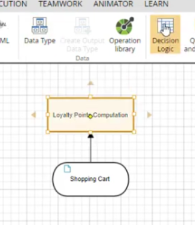
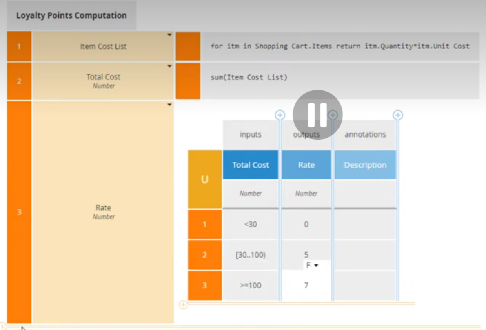
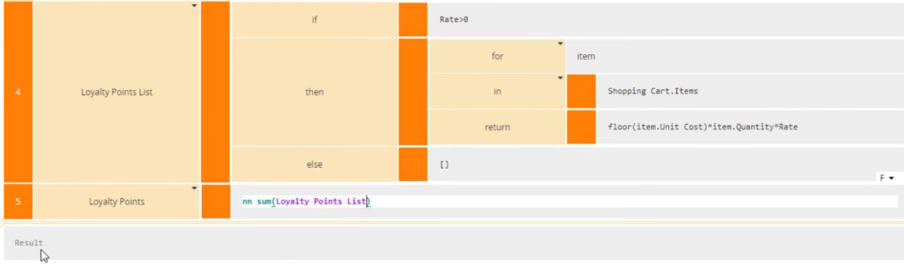
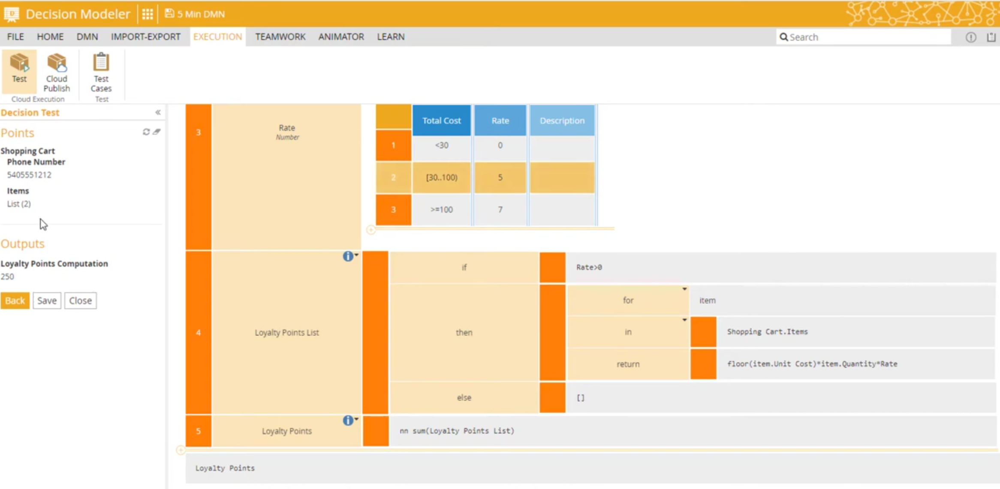
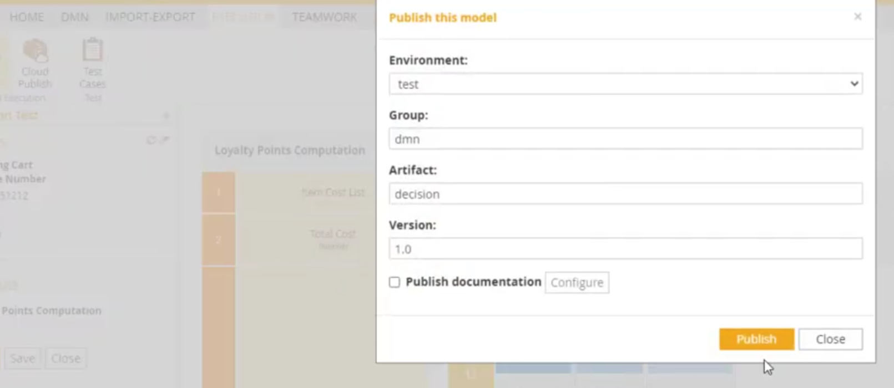
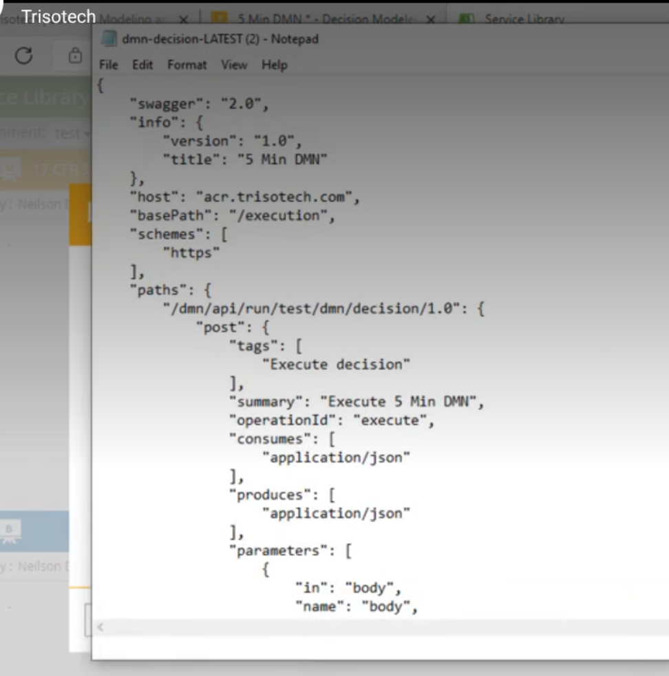

# Sesión 11 · Motores de reglas (21/10/2026)

> **RA5.** Segunda sesión. Del sistema experto «clásico» al **motor de reglas de negocio**: cómo se gestionan, versionan y despliegan las reglas como un activo de empresa.
>
> **CE de esta sesión:** RA5-b (representar y simular comportamientos básicos de ámbitos diversos).

## Cuaderno de la sesión

El código se trabaja en el cuaderno **`sesion11_motores_reglas.ipynb`**:

[Abrir en Colab](https://colab.research.google.com/github/jmperez-profesor/mia/blob/main/docs/bloques/B05_RA5/sesion11_motores_reglas.ipynb){ .md-button } · [ver en el sitio](sesion11_motores_reglas.ipynb)

## Qué vas a aprender

| # | Al terminar la sesión serás capaz de… |
|---|---|
| 1 | Explicar qué es el **decision management** y por qué un **BRMS** trata las reglas como activo |
| 2 | Leer y escribir **tablas de decisión** con su **hit policy** |
| 3 | Expresar una decisión en **DMN** y ejecutarla en un motor |
| 4 | Implementar una política con **GoRules ZEN** y con `rule-engine` (Python) |
| 5 | Verificar la **cobertura** (huecos y solapes) y decidir con un **benchmark** si merece la pena un motor |

## Vídeo · DMN en 5 minutos

<iframe width="100%" height="380" src="https://www.youtube.com/embed/Ichayb2cmQw" title="5 Min DMN" frameborder="0" allow="accelerometer; autoplay; clipboard-write; encrypted-media; gyroscope; picture-in-picture; web-share" referrerpolicy="strict-origin-when-cross-origin" allowfullscreen></iframe>

[Ver en YouTube](https://www.youtube.com/watch?v=Ichayb2cmQw) · *Trisotech*. Qué es DMN y sus tablas de decisión (en inglés).

??? note "Qué explica el vídeo"
    ### 1. Resumen

    Tom DeBevoise construye **un modelo de decisión completo en DMN 1.3** con la herramienta
    Trisotech Decision Modeler. El caso práctico: calcular los **puntos de lealtad** de un cliente a partir
    del carrito de la compra en una aplicación de punto de venta (POS), pasando por la creación de tipos de
    datos, expresiones en contexto, una **tabla de decisión**, pruebas de validación y la publicación del
    modelo como **API REST** consumible desde [Postman](https://www.postman.com/).


    ### 2. ¿Qué es DMN?

    **DMN (Decision Model and Notation)** es un estándar del *Object Management Group* (OMG), el mismo
    consorcio que mantiene BPMN, para **especificar de forma precisa decisiones y reglas de negocio** con
    una notación legible tanto para analistas de negocio como para desarrolladores.

    DMN aporta dos herramientas complementarias:

    - **Notación gráfica**: el *Decision Requirements Diagram* (DRD), que muestra las dependencias entre
      decisiones, datos de entrada (*input data*) y conocimiento de negocio (*business knowledge models*).

    - **Lenguaje de expresión FEEL** (*Friendly Enough Expression Language*): suficientemente preciso para
      que los modelos sean **ejecutables directamente**, sin traducirlos a código.


    El elemento más popular de DMN es la **tabla de decisión**:

    - Cada **fila** es una regla de negocio.
    - Las columnas de **entrada** son las condiciones (evaluadas con expresiones FEEL).
    - La columna de **salida** es el resultado cuando la regla se cumple.
    - En la **esquina superior izquierda** figura la *hit policy* (política de aciertos), que define qué
      ocurre cuando varias reglas coinciden a la vez: una sola regla (U/F) o varias agregadas (C+, C<, C>...).

    > **Idea clave:** las reglas de negocio (tramos, umbrales, tarifas) viven en una tabla editable,
    > auditable y ejecutable — **no en el código** de la aplicación.


    ### 3. Paso a paso de lo que hace el vídeo

    #### 3.1 Definición de datos de entrada

    DeBevoise construye el modelo de abajo hacia arriba:

    - Un **tipo de dato** `t_shopping_cart`: una estructura con el número de teléfono y una
      **colección de items**; cada item es a su vez una estructura con los atributos
      `sku` (Stock Keeping Unit - Unidad de gestión de existencias), `quantity` (cantidad) y `unit cost` (coste unitario).
    - Un **input data** llamado *shopping cart*, tipado como `t_shopping_cart`.
    - Una **decisión** llamada *loyalty points computation* (cálculo de puntos de lealtad).

    Este es el patrón mínimo de un DRD: **dato de entrada → decisión → resultado**.

    

    *Paso 1: fase de modelado de datos y decisión.*

    #### 3.2 La lógica de decisión como contexto por pasos

    En lugar de una única expresión gigante, la decisión se define como una **serie de pasos de contexto**
    (context steps), donde cada paso se construye sobre el anterior:

    1. **Lista de costes por item** (`item cost list`): expresión *iteradora* — para cada item del carrito,
       devolver `quantity × unit cost`.
    2. **Coste total** (`total cost`): la suma de esa lista.
    3. **Tabla de decisión para la tasa**: decide cuántos puntos se ganan por dólar en función del coste total.

    #### 3.3 La tabla de decisión (el corazón del vídeo)

    La tabla toma como entrada el `total cost` recién calculado y produce como salida la `rate`
    (tasa de puntos por dólar gastado):

    | Regla | Entrada: total cost | Salida: rate |
    |-------|--------------------|--------------|
    | 1     | < 30 $             | 0 puntos |
    | 2     | 30 $ – < 100 $     | 5 puntos por dólar |
    | 3     | ≥ 100 $            | 7 puntos por dólar |

    Es decir: por debajo de 30 $ no se ganan puntos; entre 30 y 100 $ se ganan 5 puntos por cada dólar
    completo; y a partir de 100 $, 7 puntos por cada dólar. Es un ejemplo perfecto de reglas de negocio
    que un analista funcional puede leer, validar y modificar **sin tocar código**.

    

    *Paso 2: definición de la tabla de decisión con sus reglas*

    #### 3.4 Cálculo final de los puntos

    4. **Paso condicional**: si `rate > 0`, un **paso iterador** calcula para cada item
       `floor(unit cost × quantity × rate)` (puntos por item, redondeando hacia abajo al dólar completo);
       en la rama `else` se devuelve una lista nula.
    5. **Suma final**: los puntos de lealtad se calculan con una función `not null sum`, porque la lista
       podría ser nula cuando la tasa es cero. Ese valor es el **resultado de la decisión**.

    


    ### 4. Validación, prueba y publicación como servicio

    El tramo final del vídeo muestra el **ciclo de vida completo** de un modelo de decisión:

    #### 4.1 Validación estática

    - El botón de validación comprueba el modelo DMN **sin errores**.
    - Se ejecuta el **análisis de tablas de decisión de Bruce Silver**, que detecta solapamientos, huecos
      o reglas redundantes en la tabla (tampoco con incidencias).

    #### 4.2 Prueba en modo test

    Se introducen dos items en el carrito: uno de 10 $ con cantidad 1, y otro de 20 $ con cantidad 2
    (total: 50 $). Comprobación numérica paso a paso:

    ```text
    total cost = 10 × 1 + 20 × 2 = 50 $
    regla 2 (30 ≤ 50 < 100)  →  rate = 5
    item 1:  floor(10 × 1 × 5) = 50 puntos
    item 2:  floor(20 × 2 × 5) = 200 puntos
    -------------------------------
    resultado: 250 puntos de lealtad
    ```

    El propio entorno **resalta en naranja la regla 2** que se ha disparado, lo que permite trazar qué regla
    de negocio produjo cada resultado (*explainability* de las decisiones).

    

    *Paso 4: prueba del modelo y publicación como servicio REST.*

    #### 4.3 Publicación en la nube como API REST

    1. El modelo se publica en la **biblioteca de servicios** de Trisotech (*cloud publish*).

    

    2. Se descarga la definición de la API en **JSON (Swagger / OpenAPI)**, que describe el endpoint REST.

    

    3. La especificación se **importa en Postman** como colección.
    4. Se configura la **autorización OAuth 2**.
    5. Se lanza una petición `POST` con el mismo cuerpo de prueba (10 $ × 1 y 20 $ × 2) y se obtiene de
       nuevo **250 puntos**, esta vez **fuera del entorno de modelado**: la decisión ya es un servicio
       consumible desde cualquier aplicación.

    


    ### 5. Por qué es relevante para el curso de IA y Big Data

    - **Separación de reglas y código**: la lógica de negocio vive en una tabla editable y auditable.
      Cambiar una regla no exige reprogramar ni redesplegar la aplicación.
    - **Decision-as-a-Service**: el vídeo muestra el patrón de exponer la lógica de decisión como API REST
      versionada, consumible desde cualquier aplicación. Es exactamente la arquitectura con la que se
      combinan **reglas de negocio y modelos de ML** en sistemas reales: las reglas deterministas se
      resuelven con DMN; lo probabilístico, con modelos. El estándar DMN declara compatibilidad con Java,
      **PMML y ONNX** para integrar modelos predictivos.
    - **Trazabilidad y validación**: el resaltado de la regla disparada y el análisis de tablas son
      argumentos de *explainability* frente a las "cajas negras" de **ML**.
    - **Hit policies**: aunque el vídeo no las profundiza, la esquina superior izquierda de toda tabla DMN
      indica si puede dispararse una sola regla (U/F) o varias y cómo se agregan (C+, C<, C>...), porque es
      lo que define la semántica de la tabla ante solapamientos.


    ### Referencias

    - Vídeo original: [5 Min DMN — Trisotech](https://www.youtube.com/watch?v=Ichayb2cmQw)
    - [OMG — Decision Model and Notation (DMN)](https://www.omg.org/dmn/)
    - [Especificación DMN v1.4 (PDF)](https://www.omg.org/spec/DMN/1.4/PDF)
    - [Camunda — DMN Tutorial](https://camunda.com/dmn/)
    - [Drools — DMN Documentation](https://docs.drools.org/latest/drools-docs/drools/DMN/index.html)

    *Nota: las imágenes incrustadas son fotogramas capturados del vídeo original de YouTube. El vídeo y su contenido
    pertenecen a Trisotech.*

## 1 · Decision management

**Decision management** es tratar las reglas como un **activo de negocio** gestionable por el área que las posee, no como código disperso. Un **BRMS** (*Business Rule Management System*) permite versionar, probar y desplegar reglas sin tocar la aplicación. Herramientas: **Drools/Apache KIE**, **IBM ODM**, **FICO Blaze**, **SAP BRF+**.

Un BRMS separa el **qué** (las reglas) del **cómo** (la aplicación). La persona de negocio cambia una regla y la despliega sin que intervenga desarrollo.

## 2 · Tablas de decisión y *hit policy*

Una **tabla de decisión** cruza condiciones con acciones. La **hit policy** define qué hacer cuando varias filas encajan:

| Hit policy | Significado |
|---|---|
| **First** | Gana la primera fila que encaja |
| **Unique** | Solo una puede encajar (si no, error de cobertura) |
| **Priority** | Gana la de mayor prioridad |
| **Collect** | Devuelve todas las que encajan (suma, mínimo, lista…) |

La *hit policy* es la respuesta formal al **fallo didáctico** del micro-motor de la sesión anterior (dos reglas contradictorias sobre el mismo hecho).

## 3 · DMN (Decision Model and Notation)

**DMN** (OMG) es el estándar para expresar decisiones como tablas legibles por negocio. Una **tabla de decisión** cruza las condiciones (las columnas) con una **acción** (la última columna); el guion `—` significa «no importa».

### Ejercicio · Completa la política de Pagarium

La primera fila está resuelta como ejemplo. Completa la columna **Decisión** de las otras tres:

| Importe | Antigüedad (meses) | Intentos | Decisión |
|---|---|---|---|
| `< 500` | `>= 6` | `< 4` | **Aprobar** |
| `< 500` | `>= 6` | `>= 4` | … |
| `>= 500` | — | — | … |
| — | `< 6` | — | … |

??? tip "Solución"
    | Importe | Antigüedad | Intentos | Decisión |
    |---|---|---|---|
    | `< 500` | `>= 6` | `< 4` | Aprobar |
    | `< 500` | `>= 6` | `>= 4` | Revisar |
    | `>= 500` | — | — | Revisar |
    | — | `< 6` | — | Rechazar |

    Ojo: la fila 3 (`importe >= 500`) y la fila 4 (`antigüedad < 6`) se **solapan** cuando se cumplen las dos a la vez — por eso la hit policy `unique` fallaría ahí.

La misma tabla se despliega en Drools (KIE) o en GoRules ZEN sin reescribir la lógica.

## 4 · GoRules ZEN: el motor que se usa hoy

**GoRules ZEN** es un motor de decisiones open-source, rápido y embebible, muy usado en **fintech** (pagos, KYC, *scoring*). Define el grafo de decisión en formato **JDM** (JSON Decision Model) y se ejecuta desde Python, Node, Rust o Go. Lo montamos paso a paso.

### Paso 1 · El motor

```python
%pip install zen-engine
import json
from zen import ZenEngine

engine = ZenEngine()   # el motor que evalúa grafos JDM
```

### Paso 2 · Los nodos del grafo (con las reglas por rellenar)

Un grafo tiene **nodos** (entrada → tabla → salida). La tabla lleva `hitPolicy`, `inputs`, `outputs` y `rules`:

```python
graph = {
    "contentType": "application/vnd.gorules.decision",
    "nodes": [
        {"id": "input", "type": "inputNode", "name": "Request", "position": {"x": 0, "y": 0}},
        {"id": "table", "type": "decisionTableNode", "name": "Politica",
         "content": {
             "hitPolicy": "first",   # gana la primera fila que encaja
             "inputs":  [{"id": "i1", "field": "importe", "name": "Importe", "ref": ""}],
             "outputs": [{"id": "o1", "field": "decision", "name": "Decision", "ref": ""}],
             "rules": [
                 # TODO: escribe las reglas (condición -> decisión, como texto JSON)
             ],
         },
         "position": {"x": 200, "y": 0}},
        {"id": "out", "type": "outputNode", "name": "Response",
         "content": {"fields": [{"id": "decision", "field": "decision"}]},
         "position": {"x": 400, "y": 0}},
    ],
    "edges": [
        # TODO: conecta input -> table -> out
    ],
}
```

### Paso 3 · Rellenar las reglas y las aristas (TODO)

Las **reglas** son dicts con la condición (`i1`) y la decisión (`o1`, como texto JSON entre comillas); las **aristas** unen los nodos por su `id`:

```python
# rules:
#   {"i1": "< 500",  "_id": "r1", "o1": "\"aprobar\""}
#   {"i1": ">= 500", "_id": "r2", "o1": "\"revisar\""}
# edges:
#   {"id": "e1", "sourceId": "input", "targetId": "table"}
#   {"id": "e2", "sourceId": "table", "targetId": "out"}
```

### Paso 4 · Ejecutar

```python
decision = engine.create_decision(json.dumps(graph))   # json.dumps pasa el dict a texto JSON
print(decision.evaluate(json.dumps({"importe": 200})))  # evalúa con importe 200
```

!!! note "Versiones de ZEN"
    La API de `zen-engine` cambió entre versiones: los inputs/outputs llevan `ref` y los valores de salida van como JSON string. Si el grafo no devuelve salida, exporta uno desde el **editor de GoRules**.

## 5 · `rule-engine`: la política de Pagarium paso a paso

`rule-engine` permite escribir reglas como texto y evaluarlas contra un diccionario. Vamos a **traducir la tabla DMN a código**, pieza a pieza, como hicimos con el micro-motor de la S9.

### Paso 1 · El contexto (los hechos)

```python
%pip install rule-engine
import rule_engine

# El contexto: un diccionario con los hechos del pago (parejas nombre -> valor).
ctx = {"importe": 200, "n_intentos": 5, "antiguedad_meses": 10}
```

### Paso 2 · La regla de aprobar

`Rule(...)` guarda una condición escrita en texto; `.matches(ctx)` devuelve `True` si se cumple con esos hechos.

```python
aprueba = rule_engine.Rule("importe < 500 and antiguedad_meses >= 6 and n_intentos < 4")
print("aprueba:", aprueba.matches(ctx))   # False: n_intentos=5 no es < 4
```

### Paso 3 · Las otras tres reglas (TODO)

Escribe las tres reglas que faltan de la tabla DMN (usa `and`/`or`, `<`/`>=`):

| Fila | Condición | Decisión |
|---|---|---|
| 2 | importe < 500 **y** antigüedad ≥ 6 **y** n_intentos ≥ 4 | Revisar |
| 3 | importe ≥ 500 | Revisar |
| 4 | antigüedad < 6 | Rechazar |

```python
# TODO: escribe las tres reglas que faltan
revisar_intentos = rule_engine.Rule(...)   # fila 2
revisar_importe  = rule_engine.Rule(...)   # fila 3
rechazar         = rule_engine.Rule(...)   # fila 4
```

### Paso 4 · Probar los casos y ver el solape (TODO)

```python
reglas = {"aprobar": aprueba, "revisar_intentos": revisar_intentos,
          "revisar_importe": revisar_importe, "rechazar": rechazar}

def decidir(c):
    # TODO: devuelve los nombres de las reglas que encajan en c
    #       (pista: [nombre for nombre, r in reglas.items() if r.matches(c)])
    pass

# TODO: prueba los 4 casos (uno por fila) y este caso de SOLAPE:
#   {"importe": 600, "antiguedad_meses": 3, "n_intentos": 2}
```

!!! warning "El solape"
    El caso `importe >= 500` **y** `antigüedad < 6` engancha **dos reglas** (`revisar_importe` y `rechazar`). Eso viola la hit policy `unique`: es un **solape** que el verificador de cobertura debe detectar.

## 6 · Verificador de cobertura

Un conjunto de reglas puede tener **huecos** (casos sin cubrir) y **solapes** (varias reglas que encajan). Con `hit policy = unique`, un solape es un error. El **verificador de cobertura** comprueba que toda combinación posible tiene exactamente una decisión. Es una práctica habitual en DMN y en ZEN, y evita el fallo del micro-motor de la sesión anterior.

## 7 · Benchmark: ¿siempre necesitas un motor?

Órdenes de magnitud medidos en el material de referencia para decidir un pago:

| Motor | Tiempo/pago |
|---|---|
| `if/else` a mano | **~0,1 µs** |
| GoRules ZEN | ~54 µs |
| CLIPS (`clipspy`) | ~96 µs |
| `experta` | ~190 µs |

!!! tip "La cifra que hay que leer"
    Un motor de reglas cuesta entre 500 y 2000 veces más que un `if/else`. **No siempre es la respuesta.** Se justifica cuando hay **muchas reglas**, **cambian a menudo** y las **gestiona negocio** (BRMS); no cuando son 3 condiciones fijas.

<iframe width="100%" height="380" src="https://www.youtube.com/embed/1kbmkiMmvAA" title="Business Rule Management Systems: JBoss Drools" frameborder="0" allow="accelerometer; autoplay; clipboard-write; encrypted-media; gyroscope; picture-in-picture; web-share" referrerpolicy="strict-origin-when-cross-origin" allowfullscreen></iframe>

[Ver en YouTube](https://www.youtube.com/watch?v=1kbmkiMmvAA) · *Ilko Kovacic*. BRMS y Drools, el motor de reglas empresarial más conocido (en inglés).

??? note "Qué explica el vídeo"
    Qué es un **BRMS** y por qué **Drools/JBoss** es el motor empresarial de referencia: las reglas se gestionan, versionan y despliegan fuera del código. Conecta con el **decision management** del apartado §1.

## Actividad A2 (2 h)

Completa los **`# TODO`** del paso a paso anterior (las tres reglas y la función `decidir`), detecta el **solape** y, después, despliega la misma política con **GoRules ZEN** (§4). Compara el código y el rendimiento con el benchmark (§7). El cuaderno es `sesion11_motores_reglas.ipynb`.

## Ejercicios de autoevaluación

**1.** ¿Qué es el **decision management** y qué permite un **BRMS** que no permite el código disperso?

??? tip "Solución 1"
    Tratar las reglas como un **activo de negocio**: el área que las posee las versiona, prueba y despliega **sin tocar la aplicación**. El BRMS separa el *qué* (reglas) del *cómo* (código).

**2.** Nombra tres herramientas BRMS y en qué sector se usan.

??? tip "Solución 2"
    **Drools/Apache KIE**, **IBM ODM**, **FICO Blaze**, **SAP BRF+** — banca, seguros, telecom, etc.

**3.** Explica las *hit policies* **First**, **Unique**, **Priority** y **Collect**.

??? tip "Solución 3"
    **First**: gana la primera fila que encaja. **Unique**: solo una puede encajar (si no, error). **Priority**: gana la de mayor prioridad. **Collect**: devuelve todas (suma, mínimo, lista…).

**4.** ¿Qué es **DMN** y por qué es el «lenguaje de negocio» de las decisiones?

??? tip "Solución 4"
    Estándar OMG que expresa decisiones como **tablas** legibles por negocio, desplegables en distintos motores sin reescribir la lógica.

**5.** Dada la tabla de Pagarium (importe, antigüedad, intentos → decisión), escribe la decisión de cada caso y detecta huecos o solapes.

??? tip "Solución 5"
    Aplica la tabla del apartado **3 · DMN** fila a fila. Un **hueco** es una combinación sin fila que la cubra (p. ej. importe ≥ 500 sin fila que lo cubra); un **solape** es que dos filas encajen a la vez (contradice `unique`).

**6.** ¿Qué es el formato **JDM** y qué motor lo usa?

??? tip "Solución 6"
    **JSON Decision Model**: el grafo de decisión (nodos y aristas) que usa **GoRules ZEN**.

**7.** ¿Qué diferencia hay entre **GoRules ZEN** y **`rule-engine`**?

??? tip "Solución 7"
    **ZEN**: motor embebible, rápido, para fintech (grafo JDM, desde varios lenguajes). **`rule-engine`**: reglas ligeras en texto legible evaluadas contra un contexto, dentro de un servicio Python.

**8.** ¿Qué es el **verificador de cobertura** y qué dos defectos detecta?

??? tip "Solución 8"
    Comprueba que toda combinación posible tiene **exactamente una** decisión: detecta **huecos** (sin cubrir) y **solapes** (varias reglas).

**9.** Con el benchmark (if/else ~0,1 µs, ZEN ~54 µs, CLIPS ~96 µs, `experta` ~190 µs), ¿cuándo merece la pena un motor?

??? tip "Solución 9"
    Un motor compensa con **muchas reglas**, que **cambian a menudo** y las **gestiona negocio**; no cuando son 3 condiciones fijas (el `if/else` es 500–2000× más rápido).

## Puntos clave de la sesión

- **Decision management** = reglas como activo de negocio; **BRMS** lo permite (Drools/KIE, ODM, Blaze).
- **DMN** y las **tablas de decisión** son el lenguaje de negocio; la **hit policy** formaliza el conflicto.
- **ZEN** (fintech) y `rule-engine` (Python ligero) son dos motores con usos distintos.
- La **cobertura** garantiza que no haya huecos ni solapes.
- Un motor **no siempre compensa**: mide (µs) antes de adoptarlo.
